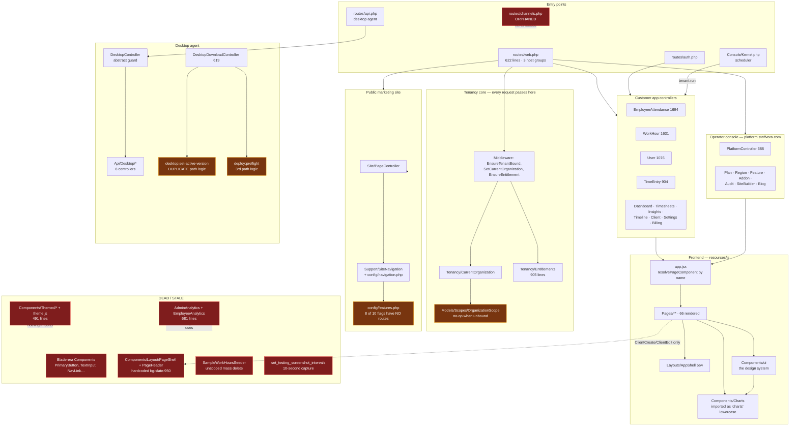

# Staffvora — File Map, Subsystem Graph & Dead Code

**Audit area:** every code file in `app/`, `resources/js/`, `routes/`, `config/`, `database/`, `tests/`, `desktop/`
**Method:** static reference resolution, not guessing. Route table dumped from `artisan route:list --json` and every action matched to a real method; every JS import resolved through the `@ → resources/js` alias; every Inertia `render('Name')` string diffed against `resources/js/Pages/**`; every config key grepped against all readers; every command signature traced to the scheduler, scripts and docs.
**Scope note:** READ-ONLY. Nothing was edited.
**Concurrency note:** `desktop/` is being actively edited by another workflow right now (untracked `desktop/main/consent.js`, `desktop/renderer/src/views/Consent.jsx`, `desktop/scripts/consent-selftest.js`, plus modified `api.js`, `ipc.js`, `preload.js`, `App.jsx`, `styles.css`). Desktop files are inventoried but **no orphan claims are made against `desktop/`** — it is mid-feature.

**Totals:** 688 files, ~144,600 lines.

---

## 1. Summary — counts by status per directory

| Directory | Files | Lines | LIVE | ORPHANED | STALE | Notes |
|---|---:|---:|---:|---:|---:|---|
| `app/Billing/` | 2 | 83 | 2 | 0 | 0 | |
| `app/Console/` | 26 | 5,867 | 26 | 0 | 0 | 2 self-marked deprecated |
| `app/Exceptions/` | 1 | 213 | 1 | 0 | 0 | |
| `app/Http/` | 96 | 23,682 | 96 | 0 | 0 | 1 controller method renders a missing page |
| `app/Jobs/` | 2 | 362 | 2 | 0 | 0 | |
| `app/Listeners/` | 1 | 44 | 1 | 0 | 0 | |
| `app/Models/` | 49 | 6,759 | 49 | 0 | 0 | 2 `@deprecated` methods |
| `app/Notifications/` | 3 | 161 | 3 | 0 | 0 | |
| `app/Providers/` | 5 | 221 | 4 | **1** | 0 | BroadcastServiceProvider disabled |
| `app/Services/` | 19 | 6,010 | 19 | 0 | 0 | |
| `app/Session/` | 1 | 180 | 1 | 0 | 0 | |
| `app/Support/` | 13 | 2,518 | 13 | 0 | 0 | |
| `app/Tenancy/` | 2 | 1,027 | 2 | 0 | 0 | |
| `config/` | 23 | 2,291 | 22 | **1** | 0 | `broadcasting.php` inert |
| `database/factories/` | 2 | 137 | 2 | 0 | 0 | |
| `database/migrations/` | 94 | 6,079 | 93 | 0 | **1** | dev-only interval override ships to prod |
| `database/seeders/` | 10 | 2,997 | 8 | **1** | **1** | |
| `routes/` | 5 | 881 | 4 | **1** | 0 | `channels.php` never loaded |
| `resources/js/` | 182 | 41,444 | 148 | **32** | **2** | ~2,150 dead lines |
| `desktop/` | 30 | 8,351 | 30 | — | — | mid-edit, not assessed |
| `tests/` | 122 | 35,315 | 122 | 0 | 0 | all reachable |

**Health verdict:** the PHP layer is genuinely clean — **all 311 routes resolve to methods that exist**, no orphaned controller, service, model, job, middleware or notification, and almost no commented-out code anywhere in the repo. The rot is concentrated in `resources/js/` (an abandoned parallel component system) and in a handful of dangerous leftovers in `database/`.

---

## 2. Subsystem graph



---

## 3. Findings

### BROKEN

#### B1. 15 case-mismatched imports — `npm run build` cannot succeed on Linux
**Files:** 9 JSX/JS files · **Evidence:** git tracks the directory as `resources/js/Components/**Charts**/` and the file as `Components/ui/**button**.jsx`, but the imports say `charts` and `./Button`.

```
resources/js/Pages/Dashboard.jsx:35            @/Components/charts        -> Components/Charts/index.js
resources/js/Pages/Dashboard.jsx:36            @/Components/charts/theme  -> Components/Charts/theme.js
resources/js/Pages/Insights/Index.jsx:24       @/Components/charts
resources/js/Pages/PlatformPortal/Dashboard.jsx:3  @/Components/charts
resources/js/Pages/Team/Apps.jsx:6             @/Components/charts
resources/js/Pages/Team/Index.jsx:21           @/Components/charts
resources/js/Pages/Timesheets/Show.jsx:23      @/Components/charts
resources/js/Pages/WorkHoursReport.jsx:27      @/Components/charts
resources/js/Pages/DesignKit.jsx:13,14         @/Components/charts, .../theme
resources/js/Components/ui/KpiCard.jsx:2,3     @/Components/charts, .../theme
resources/js/Components/ui/index.js:8          ./Button                   -> ui/button.jsx
resources/js/Components/ui/Locked.jsx          ./Button                   -> ui/button.jsx
```

**Why it is wrong:** `vite.config.js` aliases `@` to a plain path with no case-insensitive fallback. Windows and macOS resolve these; ext4 does not. `.github/workflows/ci.yml` runs `npm run build` on `runs-on: ubuntu-latest` — that job cannot pass. Production is unaffected *today* only because `public/build/` is committed (173 tracked files) and built on Windows; the moment anyone builds on the server or trusts CI, the whole frontend fails to compile.
**Fix:** rename the imports to match the real casing (`@/Components/Charts`, `./button`) — or rename `button.jsx` → `Button.jsx` and keep the import. Do it with `git mv` so the rename is recorded on case-insensitive checkouts. Then confirm the CI `Build web application` step goes green.
**Honest caveat:** I could not execute a Linux build to observe the failure; the conclusion is from the tracked casing plus the alias config plus the CI runner image.

#### B2. `GET /upwork-profiles/{id}` renders a page that does not exist
**File:** `app/Http/Controllers/UpworkProfileController.php:134` renders `Inertia::render('UpworkProfiles/Show', …)`.
**Evidence:** `resources/js/Pages/UpworkProfiles/Show.jsx` does not exist. It is the only one of the 66 rendered page names with no file. The route is registered and reachable: `routes/web.php:401`, name `upwork-profiles.show`, behind `entitlement:upwork_profiles` + `permission:profiles.view`.
**Why it is wrong:** Inertia throws on an unresolvable page component, so any workspace entitled to Upwork profiles gets a hard client-side failure on that URL.
**Fix:** either create `Pages/UpworkProfiles/Show.jsx`, or delete `show()` and route 401 and point the list's row link at `.edit` instead.

---

### WRONG

#### W1. A dev-only migration ships to production and forces 10-second screenshots
**File:** `database/migrations/2026_06_09_000006_set_testing_screenshot_intervals.php`
**Evidence chain:** `…000004_create_monitoring_settings_table.php:27-30` seeds the row with the intended `300 / 600 / 60`. This migration then `UPDATE`s `monitoring_settings` id=1 to `screenshot_interval_min_seconds = 10`, `max = 10`, `activity_sample_interval_seconds = 10`. Grepping `screenshot_interval_min_seconds` across all 94 migrations returns only those two files — **nothing ever resets it**. Its own docblock says *"Testing override … When you're ready to use realistic intervals again, run this in tinker"*.
**Why it is wrong:** `php artisan migrate --force` is the documented production deploy step. On the first organization this yields ~360 screenshots/hour/user instead of ~6-12 — a storage, bandwidth, S3-cost and privacy problem, and it silently contradicts `MonitoringSetting::current()`, which creates every *later* org at 300/600/60. Two orgs on the same install get different capture rates for no reason a user can see.
**Fix:** replace the file body with a no-op (keep the filename so the `migrations` table entry stays valid on installs that already ran it), or add a follow-up migration that restores 300/600/60 for id=1. Do not simply delete the file — that would break `migrate:rollback` bookkeeping on existing installs. **UNSURE which of the two the owner prefers; both are safe.**

#### W2. `SampleWorkHoursSeeder` will delete a week of hours for every tenant
**File:** `database/seeders/SampleWorkHoursSeeder.php:26`
```php
WorkHour::whereDate('date', '>=', Carbon::now()->subDays(7))->delete();
```
**Evidence:** the file has **zero** references anywhere in `app/`, `database/`, `tests/` — it is not even listed in `DatabaseSeeder`'s comment block of "internal-only seeders", unlike its five siblings. It contains **zero** mentions of `organization`. And `app/Models/Scopes/OrganizationScope.php:23` documents that the scope "is a no-op" when no organization is bound — which is exactly the console context of `php artisan db:seed`.
**Why it is wrong:** an unscoped mass delete of billable time across every customer, one plausible typo away (`--class=SampleWorkHoursSeeder`). It also queries `User::where('role','member')` — a pre-multi-tenant shape.
**Fix:** delete the file. See §5.

#### W3. `DatabaseSeeder` contradicts itself about org-less users
**File:** `database/seeders/DatabaseSeeder.php`
**Evidence:** lines 17-20 state *"a fresh product install must not create any org-less users"*. Lines 31-36 of the same file then advertise `php artisan db:seed --class=DemoDataSeeder`. `DemoDataSeeder` contains **zero** mentions of `organization` and creates a user. `documents/SECURITY.md:46` says *"Never create a user without an organization"*, and `php artisan tenancy:audit` exits non-zero when one exists — a check `documents/PRODUCTION_DEPLOYMENT.md:651` requires to pass after every deploy.
**Why it is wrong:** following the file's own instructions breaks the invariant the file's own preamble states, and fails the post-deploy gate.
**Fix:** `DemoDataSeeder` is superseded by `app/Services/DemoDataService.php` (493 lines, tenant-aware, has a `remove()` path, driven by `staffvora:demo-data` and the dashboard button). Delete the seeder and drop its line from the comment, or make it require `--tenant`. Same question applies to `ClientSeeder` and `UpworkProfileSeeder` (both org-less, both only referenced from that comment) — **UNSURE**, they may be intentionally kept for the internal Sparking Asia workspace.

#### W4. `config/features.php` promises engines that do not exist
**File:** `config/features.php:13-14` — *"Each section's engine (index + item template + data source) is built behind its flag … so turning it on later is just content."*
**Evidence:** grepping `routes/web.php` for each flag: `integrations` → 3 hits (real). `blog` → real. **`tools`, `guides`, `glossary`, `industries`, `comparisons`, `customer_stories`, `careers`, `affiliates` → 0 hits each.** Meanwhile `config/navigation.php:34-72` wires nav items to those flags, and `app/Support/SiteNavigation.php:46,80` only checks the flag — items declared with `url` (not `page`) are never slug-validated.
**Why it is wrong:** flipping any of those 8 booleans — which the file explicitly invites as a one-line launch — puts a header/footer link on the live marketing site pointing at a URL that 404s. The comment is a trap.
**Fix:** correct the comment to say which sections are actually built (`blog`, `integrations`), and either delete the 8 unbuilt flags or have `SiteNavigation` drop an item whose `url` has no matching route.

#### W5. Three files disagree about where desktop installers live
| File | Answer |
|---|---|
| `app/Http/Controllers/DesktopDownloadController.php:566-572` | `installers_path` **+** `config('desktop.fallback_paths')` — correct |
| `app/Console/Commands/DesktopSetActiveVersion.php:80` | `installers_path` + two **hardcoded** paths, ignoring `fallback_paths` |
| `app/Console/Commands/DeployPreflight.php:569` | `installers_path` **only** |

**Why it is wrong:** `config/desktop.php:32` exists precisely to hold that fallback list. Editing it changes the download page's behaviour but not the publish command's, and `deploy:preflight` can report "no installers" while the download page serves them fine (or vice versa). `DESKTOP_RELEASE_CHECKLIST.md:387` tells the operator to trust preflight's verdict.
**Fix:** extract one `DesktopInstallers::searchDirs()` helper and have all three call it.

#### W6. `DesktopSetActiveVersion` hardcodes installer filenames, including two dead brands
**File:** `app/Console/Commands/DesktopSetActiveVersion.php:116`
```php
foreach (["Staffvora Desktop Setup {$version}.exe", "SA Track Setup {$version}.exe", "Timetracker Desktop Setup {$version}.exe"] as $name)
```
**Why it is wrong:** this is the gate that decides whether a release can be published — line 66 *refuses* to activate a version whose installer it cannot find. `DesktopDownloadController` discovers installers by pattern, not by a fixed list, so the two can disagree; and if `desktop/package.json`'s `productName` ever changes again, publishing silently breaks with "installer missing" while the file is sitting right there. The `SA Track` / `Timetracker` entries are leftovers from two prior product names.
**Fix:** derive the expected name from config/the manifest, or glob `*Setup {$version}.exe` like the controller does.

#### W7. `.env.bak.prerename` is committed to git with a real `APP_KEY`
**Evidence:** `git ls-files` lists it (committed in `4bcf336`). `.gitignore` covers `.env` and `.env.backup` but not this name. It contains a populated 51-char `APP_KEY` that is **identical to the current local `.env`**, plus `MAIL_*` and `REDIS_PASSWORD` entries.
**Honest severity:** the contents are the **local** dev environment (`APP_ENV=local`, `APP_DEBUG=true`, `APP_URL=http://tracksuite.test`, `MAIL_HOST=mailpit`) — **not** production credentials. So this is a hygiene and pre-rename-leftover problem, not an active compromise.
**Fix:** `git rm --cached .env.bak.prerename`, delete the file, add `.env.*` to `.gitignore`. Also note `database/database.sqlite.corrupt.bak` (491 KB) sits untracked but **unignored** (`/database/*.sqlite` does not match it) so a `git add .` would commit it.

#### W8. Stale brand strings in live code
| File:line | String | Impact |
|---|---|---|
| `resources/js/Components/Site/SiteShell.jsx:6` | `STORAGE_KEY = 'tracksuite-site-theme'` | live on staffvora.com; works, but the public theme preference is stored under a dead brand key |
| `resources/js/Pages/Timeline/Index.jsx:714` | `window.location.href = 'tracksuite://open'` | `desktop/main/main.js:20` explicitly says *"grep for `tracksuite://` in resources/js first"* before dropping the legacy protocol — this line is the thing blocking that cleanup |
| `desktop/renderer/src/views/Login.jsx:55,56` | `<h1>Tracksuite Desktop</h1>`, "Sign in with your Tracksuite account." | **the shipped desktop app still shows the old product name to users** |
| `desktop/renderer/src/views/Tracker.jsx:686,701` | `'Tracksuite'` fallback + brand label | same |
| `desktop/renderer/index.html:7` | `<title>Tracksuite Desktop</title>` | window title |
| `start-dev.ps1:1,4` | "Time Tracker" | orphaned script, cosmetic |

`app/Console/Commands/DeployPreflight.php:549` already fails a deploy when `tracksuite`/`timetracker` appears in the brand env vars — the same rule is not applied to shipped strings.

#### W9. `ErrorBoundary` swallows every React crash in production
**File:** `resources/js/Components/ErrorBoundary.jsx:28` — `// TODO: Log to error tracking service (e.g., Sentry, Bugsnag)`
**Why it matters:** this is the app's only top-level React catch (wired in `app.jsx:8`). Any page-level crash shows the fallback and is reported nowhere, so the owner's "there are a lot of issues" has no telemetry behind it. This is the only actionable TODO in the entire repo.

---

### UGLY

#### U1. `ClientCreate` and `ClientEdit` render on a hardcoded black slab
**Files:** `resources/js/Components/Layout/PageShell.jsx`, `resources/js/Components/Layout/PageHeader.jsx`
```jsx
// PageShell.jsx
<div className="min-h-screen bg-slate-950">
  <div className={`mx-auto ${width} …`}>       // called with width="max-w-5xl"
// PageHeader.jsx
className="… border-b border-slate-800 …"
<h1 className="… text-white"><span className="… bg-gradient-to-b from-orange-400 to-amber-500" />
{description && <p className="… text-slate-400">}
```
**Used by exactly two live pages** — `ClientCreate.jsx:5-6,120` and `ClientEdit.jsx:5-6,126` — nested *inside* `AuthenticatedLayout` → `AppShell`.
**Three problems at once:**
1. **Token violation / theme break:** `bg-slate-950` is a hardcoded near-black. The app's default theme is light, so `/clients/create` and `/clients/{id}/edit` paint a black rectangle inside a light shell. `text-white` on it, `text-slate-400` for the description.
2. **Wrong accent:** an orange→amber gradient tick, while the product accent is `bg-accent` (electric blue). This is the only orange in the app.
3. **Centering the owner called out:** `mx-auto max-w-5xl` caps these forms at 1024 px and centres them, against the stated "fill the page" rule, while every other page uses `AppShell`'s full-width chrome.

**Meanwhile** the correct, token-based `resources/js/Components/PageHeader.jsx` exists and is used by exactly **one** page (`Help/Index.jsx`). The worse implementation has twice the adoption.
**Fix:** migrate ClientCreate/ClientEdit onto `Components/PageHeader.jsx` + plain `AppShell` width, then delete `Components/Layout/` entirely (`Panel.jsx` there is already orphaned and uses `border-slate-200 bg-white`).

#### U2. `WorkHourCreate.jsx` and `WorkHourEdit.jsx` are ~67% the same file
**Evidence:** whitespace-insensitive diff of the two files reports 633 differing lines out of 1,945 total — roughly **1,300 duplicated lines**, the largest duplication in the codebase.
**Why it matters:** every validation rule, every field, every keyboard behaviour has to be fixed twice, and a fix applied to one is a silent inconsistency in the other. The repo already contains the right pattern: `UserCreate.jsx` (27 lines) and `UserEdit.jsx` (29 lines) are thin wrappers over the shared `Components/Users/UserForm.jsx`.
**Fix:** extract `Components/WorkHours/WorkHourForm.jsx` exactly as `UserForm` was done. `ClientCreate`/`ClientEdit` have the same disease at smaller scale (209 differing lines of ~880).

#### U3. Files over 800 lines doing too much
| File | Lines |
|---|---:|
| `resources/js/Pages/EmployeeAttendance.jsx` | 2,359 |
| `app/Http/Controllers/EmployeeAttendanceController.php` | 1,694 |
| `app/Http/Controllers/WorkHourController.php` | 1,631 |
| `database/seeders/BigOrgSeeder.php` | 1,579 |
| `resources/js/Pages/Settings/Index.jsx` | 1,418 |
| `resources/js/Pages/Compliance/Index.jsx` | 1,215 |
| `resources/js/Pages/Dashboard.jsx` | 1,194 |
| `resources/js/Pages/Timeline/Index.jsx` | 1,168 |
| `app/Http/Controllers/ComplianceController.php` | 1,139 |
| `resources/js/Pages/WorkHoursReport.jsx` | 1,131 |
| `app/Http/Controllers/UserController.php` | 1,076 |
| `resources/js/Pages/UsersList.jsx` | 1,044 |
| `resources/js/Pages/ClientsList.jsx` | 1,006 |
| `resources/js/Pages/WorkHourEdit.jsx` | 995 |
| `resources/js/Pages/WorkHoursList.jsx` | 982 |
| `resources/js/Pages/Insights/Index.jsx` | 953 |
| `resources/js/Pages/WorkHourCreate.jsx` | 950 |
| `app/Tenancy/Entitlements.php` | 905 |
| `app/Http/Controllers/TimeEntryController.php` | 904 |
| `app/Services/InsightsAggregator.php` | 850 |
| `resources/js/Pages/Platform/Show.jsx` | 841 |
| `app/Models/User.php` | 840 |

`Billing/Index.jsx` shows the pattern that works: a 413-line page that delegates to four tab files. `EmployeeAttendance.jsx` at 2,359 lines is the clearest candidate for the same treatment.

#### U4. Five pairs of migrations share a timestamp
```
2026_06_09_000006  extend_monitoring_settings_with_scrinio_fields / set_testing_screenshot_intervals
2026_06_11_000001  add_attendance_and_report_indexes           / normalise_tracker_manual_work_type
2026_07_29_000001  add_archive_lifecycle_columns               / create_feedback_tables
2026_07_29_400000  add_organization_leading_composite_indexes  / create_work_categories_and_split_work_vocabulary
2026_08_02_180000  add_insights_aggregation_index              / create_timesheets_and_pay_periods
```
**Why it matters:** with equal timestamps Laravel orders by filename, so the order is alphabetical by accident. `2026_08_02_180000_add_insights_aggregation_index` sorts *before* `…create_timesheets_and_pay_periods` — fine today, but any pair where the index migration touches a table the other creates would fail on a fresh install and pass on an existing one. Also, `…with_scrinio_fields` carries a third-party product name in a filename.
**Fix:** bump one of each pair by a second. Only safe on installs that have not run them; on production the `migrations` table already records the old names, so **UNSURE** — treat as a note, not an action.

#### U5. The broadcasting subsystem is 108 lines of inert scaffolding
`config/app.php:177` has `// App\Providers\BroadcastServiceProvider::class,` **commented out**, so `routes/channels.php` is never required. No `broadcast()`, no `ShouldBroadcast`, no `Echo` anywhere in `app/` or `resources/js/`; `resources/js/bootstrap.js:18,20` has the Echo/Pusher imports commented out; `config/broadcasting.php` has zero readers.

---

### NIT

- **Unused npm dependencies** — `react-hook-form`, `@hookform/resolvers`, `zod`, `clsx`, `tailwind-scrollbar-hide` have **zero** imports in `resources/js`, and `tailwind.config.js:68` is `plugins: [forms]` only. `clsx` exists for `resources/js/lib/utils.js`, which is a 0-byte file.
- **Five 0-byte component files** — `ClientCombobox.jsx`, `FloatingActionButton.jsx`, `NotificationCenter.jsx`, `ProductivityInsights.jsx`, `lib/utils.js`. They resolve, import fine, and export nothing.
- **`@deprecated` markers still in place** — `app/Models/Plan.php:100` (`use entitlement()`), `app/Models/Organization.php:338` (`use can()`), `app/Console/Commands/CreateAdminUser.php:28`, `database/seeders/AdminUserSeeder.php:12`.
- **`LazyLoad.jsx` is half dead** and violates tokens in the half that runs — `border-blue-600`, `text-gray-600 dark:text-gray-400` in `LoadingFallback`.
- **Highest token-violation counts** (raw `slate-`/`gray-`/`zinc-`/`bg-white`/hex): `Welcome.jsx` 32 (orphaned), `AiChatWidget.jsx` 29, `Pagination.jsx` 27, `Utils/notifications.js` 22, `Site/SiteShell.jsx` 21, `PlatformAuth/AcceptInvite.jsx` 18, `theme.js` 17 (orphaned), `Settings/Branding.jsx` 14, `Teams/Index.jsx` 13, `PlatformAuth/Login.jsx` 13, `ErrorBoundary.jsx` 12. *(Detailed styling belongs to the per-page auditors; listed here as a map of where the debt sits.)*
- **Orphaned root files** — `SAMPLE_BEAUTIFUL_DESIGN.jsx` (tracked, 8.3 KB, zero references), `setup-storage.sh`, `start-dev.bat`, `start-dev.ps1` (all zero references; the desktop has its own `desktop/scripts/start-dev.ps1` which *is* wired to `npm run dev:setup`).
- **Genuinely clean:** across `app/`, `routes/`, `database/` and `resources/js` there are only **three** commented-out code lines and **one** TODO. No FIXME, no HACK, no XXX. That is unusually disciplined and worth not regressing.

---

## 4. Reference-integrity checks that PASSED

Recording these so the next round does not re-do them:

| Check | Result |
|---|---|
| All 311 routes → controller method exists | **PASS** (only false positive: vendor `sanctum/csrf-cookie`) |
| Public controller methods never routed | **none** |
| Controllers not referenced by a route | **none** (`DesktopController` is an abstract base with 8 subclasses; `CalculatesTimeStats` is a trait; `Controller` is the base) |
| Services / Support / Jobs / Notifications / Listeners with no references | **none** |
| Middleware not registered | **none** (`LeanSessionStart` is bound in `AppServiceProvider:35`, `SharePlatformUser` is applied in `routes/web.php`) |
| Models unreferenced | **none** |
| Inertia render names with no page file | **1** — `UpworkProfiles/Show` (B2) |
| Page files never rendered | **1** — `Welcome.jsx` |
| Artisan commands unreachable | **none** — every signature appears in `Console/Kernel.php`, `deploy-production.sh`, or the runbooks |
| `config/brand.php` "unread" keys | **false alarm** — all consumed via `config('brand')` in `Support/SiteContext.php:18` |

---

## 5. Prioritised "safe to delete" list

Each entry names the evidence. Ordered by risk removed, then by lines recovered.

| # | Target | Lines | Evidence that nothing uses it | Confidence |
|---|---|---:|---|---|
| 1 | `database/seeders/SampleWorkHoursSeeder.php` | 58 | Zero references in `app/`, `database/`, `tests/`. Not listed in `DatabaseSeeder`'s comment block, unlike all 5 siblings. Contains an **unscoped** `WorkHour::…->delete()`. | **HIGH — delete** |
| 2 | `resources/js/Components/Themed/` (7 files) + `resources/js/theme.js` | 491 | `Themed/index.js` has **zero** importers. Each `Themed/*` file's only importer is `Themed/index.js`. `theme.js`'s only importers are the `Themed/*` files. Fully closed dead subtree. | **HIGH — delete** |
| 3 | `resources/js/Components/AdminAnalytics.jsx` + `EmployeeAnalytics.jsx` | 681 | Only referenced by `LazyLoad.jsx:26,27` (`LazyEmployeeAnalytics`, `LazyAdminAnalytics`). Grep of all of `resources/js` shows **no page imports either export**, nor `AnalyticsWrapper`. Confirms the reported lead. | **HIGH — delete** (also drop those 2 exports + `AnalyticsWrapper` from `LazyLoad.jsx`) |
| 4 | 5 empty files: `ClientCombobox.jsx`, `FloatingActionButton.jsx`, `NotificationCenter.jsx`, `ProductivityInsights.jsx`, `lib/utils.js` | 0 | 0 bytes each; resolver reports zero importers. | **HIGH — delete** |
| 5 | `production-check.sh` | 177 | **Zero** references anywhere (`deploy-production.sh:50` calls `php artisan deploy:preflight` instead). Confirms the reported lead. It is also **wrong**: it hard-fails when `node_modules/` is absent, but the documented deploy builds assets locally and ships `public/build`, so production legitimately has no `node_modules`. It also checks for `bootstrap/cache/views.php`, which Laravel never creates. `deploy:preflight` (699 lines) supersedes it in every dimension. | **HIGH — delete** |
| 6 | Blade-era components: `PrimaryButton`, `SecondaryButton`, `DangerButton`, `TextInput`, `InputLabel`, `InputError`, `Checkbox`, `NavLink`, `ResponsiveNavLink`, `TimeDisplay`, `AnimatedBackground`, `PageBackground` | ~250 | Zero importers each (Laravel Breeze scaffolding, replaced by `Components/ui/`). Note `Components/ui/Form.jsx` already exports `Input`, `Checkbox`, `Field`. | **HIGH — delete** |
| 7 | `resources/js/Layouts/GuestLayout.jsx` | 18 | Zero importers. All 6 auth pages use `AuthLayout`. (Keep `ApplicationLogo.jsx` — `AppShell`, `AuthLayout` and `PlatformLayout` also import it.) | **HIGH — delete** |
| 8 | `resources/js/Pages/Welcome.jsx` | 242 | No controller renders `'Welcome'` (checked against all 66 render strings); nothing imports it. The live homepage is `Site/Show`. Still references `app.tracksuite.io`. | **HIGH — delete** |
| 9 | `SAMPLE_BEAUTIFUL_DESIGN.jsx` (repo root) | ~230 | Tracked in git, zero references in any `.md`, `.json`, `.js`, `.php`. | **HIGH — delete** |
| 10 | `app/Providers/BroadcastServiceProvider.php` + `routes/channels.php` | 37 | Provider is commented out at `config/app.php:177`; `channels.php` is required only by that provider. No `broadcast()`/`ShouldBroadcast`/`Echo` anywhere. | **HIGH — delete** (leave `config/broadcasting.php`: harmless, and Laravel's `BroadcastManager` reads it if a package ever wakes it up) |
| 11 | `resources/js/Components/Layout/Panel.jsx` | 7 | Zero importers; uses `border-slate-200 bg-white`. | **HIGH — delete** |
| 12 | `resources/js/Utils/debug.js`, `resources/js/lib/datetime.js` | 70 | Zero importers. `Utils/timeUtils.js` is the live date/time helper (used by Dashboard, EmployeeAttendance, Profile). | **HIGH — delete** |
| 13 | npm deps `react-hook-form`, `@hookform/resolvers`, `zod`, `clsx`, `tailwind-scrollbar-hide` | — | Zero imports in `resources/js`; `tailwind.config.js:68` loads only `forms`. Remove `clsx` only together with item 4. | **MEDIUM** — verify `desktop/` does not use them before removing from the root manifest |
| 14 | `resources/js/Components/Layout/PageShell.jsx` + `Layout/PageHeader.jsx` | 23 | Currently used by `ClientCreate`/`ClientEdit`. **Not deletable until U1 is fixed** — listed so the fix and the delete happen together. | **BLOCKED on U1** |
| 15 | `database/seeders/DemoDataSeeder.php` (242), `ClientSeeder.php` (29), `UpworkProfileSeeder.php` (28) | 299 | Referenced only from a comment in `DatabaseSeeder`. All three are org-less. `DemoDataService` supersedes `DemoDataSeeder`. | **UNSURE — do not auto-delete.** `ClientSeeder`/`UpworkProfileSeeder` may be deliberately kept for the internal Sparking Asia workspace. Ask the owner. |
| 16 | `setup-storage.sh`, `start-dev.bat`, `start-dev.ps1` (repo root) | ~90 | Zero references; the root `start-dev.ps1` still says "Time Tracker". `desktop/scripts/start-dev.ps1` is a **different, live** file wired to `npm run dev:setup`. | **MEDIUM** — the owner may run these by hand |
| 17 | `.env.bak.prerename` | — | `git rm --cached` + delete + widen `.gitignore` to `.env.*`. Local-only credentials, but it should not be in the repo. | **HIGH — remove from git** |
| 18 | `database/database.sqlite.corrupt.bak` (491 KB) | — | Untracked but **not** gitignored (`/database/*.sqlite` does not match). Delete the file and/or extend the ignore rule. | **MEDIUM** |

**Total safely recoverable now (items 1-12): ~2,250 lines** plus one unscoped-delete landmine.

**Explicitly NOT recommended for deletion,** despite looking dead:
- `resources/js/Components/Charts/*` — appears orphaned to a case-sensitive resolver, but is imported 13 times as lowercase `charts`. Fix B1 instead.
- `resources/js/Components/ui/button.jsx` — same, imported as `./Button`.
- `resources/js/Layouts/AuthenticatedLayout.jsx` — a documented compatibility wrapper used by 36 pages.
- `app/Http/Controllers/Api/Desktop/DesktopController.php` — abstract base extended by all 8 desktop API controllers.
- `resources/js/Pages/DesignKit.jsx` — reachable via `Inertia::render('DesignKit')`; a legitimate internal reference page.
- Anything under `desktop/` — mid-edit by a concurrent workflow.

---

## 6. Full per-file table

Status legend: **LIVE** reachable in production · **ORPHANED** nothing references it · **STALE** contradicts current behaviour · **DUPLICATE** second implementation. Purpose is the file's own first docblock line where it has one.

| File | Lines | Status | What it is |
|---|---:|---|---|
| `app/Billing/ManualBankTransfer.php` | 56 | LIVE | Manual billing: a platform admin records a received bank transfer. Writes the |
| `app/Billing/PaymentProvider.php` | 27 | LIVE | The seam between the app and however money is collected. Today the only |
| `app/Console/Commands/AutoCloseAttendance.php` | 268 | LIVE | Safety net for forgotten clock-outs. |
| `app/Console/Commands/Benchmark.php` | 590 | LIVE | THE BENCHMARK HARNESS — "how expensive is each screen, really". |
| `app/Console/Commands/CloseStaleTrackingSessions.php` | 61 | LIVE |  |
| `app/Console/Commands/Concerns/RequiresBoundTenant.php` | 68 | LIVE | Marks a console command as PER-TENANT: it reads and writes one workspace's |
| `app/Console/Commands/CreateAdminUser.php` | 143 | LIVE (deprecated) | Self-describes as "[Deprecated — prefer tenant:create]" and prints a deprecation warning. |
| `app/Console/Commands/CreateTenant.php` | 62 | LIVE | Provision a new tenant by hand (alongside the self-serve signup). Delegates to |
| `app/Console/Commands/DeleteTenant.php` | 431 | LIVE | GDPR "right to erasure": permanently delete a tenant and ALL of its data — |
| `app/Console/Commands/DemoData.php` | 89 | LIVE | Load / remove / inspect the sample-data demo workspace from the console. |
| `app/Console/Commands/DeployPreflight.php` | 699 | LIVE | "Is this server actually ready to serve customers?" — one command, plain English. |
| `app/Console/Commands/DesktopSetActiveVersion.php` | 124 | LIVE (DUPLICATE) | Re-implements installer-dir resolution instead of reading `desktop.fallback_paths`, and hardcodes 3 installer filenames including two dead brands. |
| `app/Console/Commands/GrantPlatformAdmin.php` | 41 | LIVE | Grant (or revoke) platform-admin access by email. Used to bootstrap the SaaS |
| `app/Console/Commands/PlatformOwner.php` | 64 | LIVE | Bootstraps the operator portal: creates (or promotes) the first platform |
| `app/Console/Commands/PlatformPrune.php` | 247 | LIVE | RETENTION FOR THE PLATFORM-WIDE TABLES — the ones `tenant:run` must never touch. |
| `app/Console/Commands/PruneTrackingScreenshots.php` | 598 | LIVE | Enforces the monitoring retention period for BOTH evidence tables. |
| `app/Console/Commands/RecordPayment.php` | 82 | LIVE | Platform-admin tool: record a received bank transfer for a tenant. Optionally |
| `app/Console/Commands/ResyncWorkHours.php` | 59 | LIVE | One-off backfill: re-mirror finished tracking sessions into work_hours using |
| `app/Console/Commands/SeedBigOrg.php` | 395 | LIVE | Build the Phase 6 measurement fixture: one BIG tenant and one brand-new EMPTY |
| `app/Console/Commands/SendDailyActivityDigest.php` | 51 | LIVE |  |
| `app/Console/Commands/SendWeeklySlackReport.php` | 44 | LIVE |  |
| `app/Console/Commands/SilentTrackerCheck.php` | 493 | LIVE | Capture-health watchdog — BREAK-AWARE. |
| `app/Console/Commands/StillWorkingCheck.php` | 342 | LIVE | Friendly companion to the auto clock-out cap. When someone has been clocked |
| `app/Console/Commands/SyncSiteContent.php` | 94 | LIVE | Seeds/refreshes everything the PUBLIC marketing surface needs to render, as a |
| `app/Console/Commands/TenancyAudit.php` | 147 | LIVE | Fail-closed tenancy invariant check, runnable in CI and before a deploy. |
| `app/Console/Commands/TenantImport.php` | 206 | LIVE | Voluntarily import an existing roster into a tenant — the onboarding path for a |
| `app/Console/Commands/TenantRun.php` | 289 | LIVE | Runs another artisan command once per active organization, each bound to its |
| `app/Console/Kernel.php` | 180 | LIVE | Define the application's command schedule. |
| `app/Exceptions/Handler.php` | 213 | LIVE | ───────────────────────────────────────────────────────────────────────────── |
| `app/Http/Controllers/AiAssistantController.php` | 176 | LIVE | Manager chat over the team's recent work data. The model only ever sees |
| `app/Http/Controllers/Api/Desktop/ActivityController.php` | 56 | LIVE |  |
| `app/Http/Controllers/Api/Desktop/AuthController.php` | 247 | LIVE | Per-account + per-IP attempt budget, mirroring the web login's 5-attempt |
| `app/Http/Controllers/Api/Desktop/ConsentController.php` | 200 | LIVE | The monitoring-consent gate for the desktop agent. |
| `app/Http/Controllers/Api/Desktop/DesktopController.php` | 53 | LIVE | Base for every desktop-tracker API controller. |
| `app/Http/Controllers/Api/Desktop/DiagnosticsController.php` | 118 | LIVE | Receives the error / telemetry events the desktop tracker uploads, so |
| `app/Http/Controllers/Api/Desktop/MachineReportController.php` | 622 | LIVE | MACHINE COMPLIANCE INGEST. |
| `app/Http/Controllers/Api/Desktop/MetaController.php` | 124 | LIVE |  |
| `app/Http/Controllers/Api/Desktop/ScreenshotController.php` | 196 | LIVE | Total pixel budget for what we will STORE. |
| `app/Http/Controllers/Api/Desktop/SessionController.php` | 401 | LIVE | Start a new tracking session. Idempotent on (user_id, client_uuid) |
| `app/Http/Controllers/Api/Desktop/TimeClockController.php` | 90 | LIVE | Attendance clock for the desktop tracker: clock in/out and breaks. |
| `app/Http/Controllers/Auth/AuthenticatedSessionController.php` | 53 | LIVE | Display the login view. |
| `app/Http/Controllers/Auth/ConfirmablePasswordController.php` | 42 | LIVE | Show the confirm password view. |
| `app/Http/Controllers/Auth/EmailVerificationNotificationController.php` | 25 | LIVE | Send a new email verification notification. |
| `app/Http/Controllers/Auth/EmailVerificationPromptController.php` | 23 | LIVE | Display the email verification prompt. |
| `app/Http/Controllers/Auth/NewPasswordController.php` | 268 | LIVE | The token half of the password-reset flow, and the home of the ACCOUNT-WIDE |
| `app/Http/Controllers/Auth/PasswordController.php` | 29 | LIVE | Update the user's password. |
| `app/Http/Controllers/Auth/PasswordResetCodeController.php` | 185 | LIVE | Password reset via 6-digit code delivered through Slack — built for teams |
| `app/Http/Controllers/Auth/PasswordResetLinkController.php` | 89 | LIVE | Display the password reset link request view. |
| `app/Http/Controllers/Auth/RegisteredUserController.php` | 85 | LIVE | Self-serve signup: each registration creates a whole tenant (organization + |
| `app/Http/Controllers/Auth/VerifyEmailController.php` | 28 | LIVE | Mark the authenticated user's email address as verified. |
| `app/Http/Controllers/AvatarController.php` | 71 | LIVE | Stable, cacheable avatar proxy. The old approach minted a fresh presigned |
| `app/Http/Controllers/BillingController.php` | 506 | LIVE | The CUSTOMER BILLING HUB — four tabs: |
| `app/Http/Controllers/BrandingController.php` | 201 | LIVE | Self-service app logo. Stored on the S3-backed avatars disk so the host's |
| `app/Http/Controllers/ClientController.php` | 486 | LIVE | Archive / restore a single client. Archiving hides it from the pickers |
| `app/Http/Controllers/ComplianceController.php` | 1139 | LIVE | MACHINE COMPLIANCE — the review surface. |
| `app/Http/Controllers/Concerns/CalculatesTimeStats.php` | 184 | LIVE | Derives work/break hours, last action, and current status from a chronological |
| `app/Http/Controllers/Controller.php` | 12 | LIVE |  |
| `app/Http/Controllers/DashboardController.php` | 494 | LIVE | How far back Top projects looks. BOUNDED ON PURPOSE: this is a dashboard |
| `app/Http/Controllers/DesktopDownloadController.php` | 619 | LIVE | The human-facing /desktop-downloads page and the raw installer downloads. |
| `app/Http/Controllers/DeveloperController.php` | 717 | LIVE | Internal system panel for Super Admins. Shows environment/health state and |
| `app/Http/Controllers/EmployeeAttendanceController.php` | 1694 | LIVE | Bounds for the bulk calendar writer. The endpoint used to be unbounded on |
| `app/Http/Controllers/FeedbackController.php` | 244 | LIVE | The feedback / request inbox, as lightweight tickets. Anyone files a request |
| `app/Http/Controllers/HelpController.php` | 20 | LIVE | The in-app help / FAQ centre. Content lives in the page component (it's static |
| `app/Http/Controllers/InsightsController.php` | 179 | LIVE | INSIGHTS v1 — utilization vs target, the activity gauge, the billable / |
| `app/Http/Controllers/MonitoringController.php` | 338 | LIVE | Delete several screenshots at once (e.g. a whole "watched YouTube" |
| `app/Http/Controllers/OnboardingController.php` | 321 | LIVE | First-run setup wizard (tracker item B1). After a self-serve signup the owner |
| `app/Http/Controllers/Platform/AccountController.php` | 46 | LIVE |  |
| `app/Http/Controllers/Platform/AddonController.php` | 398 | LIVE | ADD-ONS — sellable bundles of entitlements that attach to a company on top of |
| `app/Http/Controllers/Platform/AuditController.php` | 158 | LIVE | THE OPERATOR AUDIT TRAIL — "who changed this company's access, and when". |
| `app/Http/Controllers/Platform/AuthController.php` | 52 | LIVE | Login/logout for the operator portal — the `platform` guard, separate from |
| `app/Http/Controllers/Platform/BlogController.php` | 160 | LIVE | No-code blog management in the Platform console (platform-admin only). Mirrors |
| `app/Http/Controllers/Platform/FeatureController.php` | 308 | LIVE | THE FEATURE CATALOGUE editor — this is what makes "add or remove features |
| `app/Http/Controllers/Platform/InvitationController.php` | 72 | LIVE | Guest-facing accept flow for an operator invitation. Authorized purely by the |
| `app/Http/Controllers/Platform/LeadController.php` | 46 | LIVE | Leads inbox — contact-form submissions from the marketing site. Platform-admin |
| `app/Http/Controllers/Platform/PlanController.php` | 506 | LIVE | PLAN LIFECYCLE for the operator portal — create, rename, duplicate, archive, |
| `app/Http/Controllers/Platform/PortalController.php` | 25 | LIVE | The operator portal's own pages (dashboard, later: staff management). The |
| `app/Http/Controllers/Platform/RegionController.php` | 456 | LIVE | REGION PRICING RULES for the operator portal — "which plans may this part of |
| `app/Http/Controllers/Platform/SiteBuilderController.php` | 415 | LIVE | The no-code page builder, platform-admin only (routes are under the |
| `app/Http/Controllers/Platform/StaffController.php` | 97 | LIVE | Owner-only staff management for the operator portal: list staff, invite by |
| `app/Http/Controllers/PlatformController.php` | 714 | LIVE | The platform (landlord) console: the SaaS operator manages every tenant. All |
| `app/Http/Controllers/ProfileController.php` | 239 | LIVE | Display the user's profile form. |
| `app/Http/Controllers/SchedulerController.php` | 31 | LIVE | Run the Laravel scheduler over HTTP, authenticated by a shared token. |
| `app/Http/Controllers/SettingsController.php` | 847 | LIVE | Hard ceiling on how many work categories one workspace may hold (active + |
| `app/Http/Controllers/ShiftOverrideController.php` | 233 | LIVE | One-day shift changes. A member with `shift.edit_own` manages their OWN |
| `app/Http/Controllers/Site/BlogController.php` | 85 | LIVE | Public marketing blog — /blog (index) and /blog/{slug} (post). Renders through |
| `app/Http/Controllers/Site/ContactController.php` | 60 | LIVE | Marketing contact form. Emails the message to the brand support address ONLY |
| `app/Http/Controllers/Site/PageController.php` | 435 | LIVE | Renders the public, builder-driven marketing website (home + any published |
| `app/Http/Controllers/SlackInteractionController.php` | 300 | LIVE | Receives Slack interactive button clicks (the "still working?" check). |
| `app/Http/Controllers/SlackReportController.php` | 53 | LIVE |  |
| `app/Http/Controllers/TeamController.php` | 467 | LIVE | Hard ceiling (in calendar days, inclusive) on a caller-supplied custom |
| `app/Http/Controllers/TeamManagementController.php` | 57 | LIVE | Org-owner management of customizable Teams (groups of users). Distinct from |
| `app/Http/Controllers/ThemeController.php` | 27 | LIVE | Persists a user's personal theme choice (light/dark/black). The workspace |
| `app/Http/Controllers/TimeEntryController.php` | 904 | LIVE | Hard ceiling (in calendar days, inclusive) on any caller-supplied date |
| `app/Http/Controllers/TimelineController.php` | 498 | LIVE | AI summary of one person's day. Cached per user+date so repeat clicks |
| `app/Http/Controllers/TimesheetApprovalController.php` | 705 | LIVE | TIMESHEET APPROVALS — the surface that makes tracked time payable. |
| `app/Http/Controllers/UpworkProfileController.php` | 233 | LIVE (BROKEN method) | `show()` renders Inertia page "UpworkProfiles/Show", which does not exist. GET /upwork-profiles/{id} cannot render. |
| `app/Http/Controllers/UserController.php` | 1076 | LIVE | Add a named shift to this workspace's curated list (Morning / Noon / |
| `app/Http/Controllers/WorkHourController.php` | 1631 | LIVE | LEGACY vocabulary. The one flat list that conflated capture method, work |
| `app/Http/Kernel.php` | 121 | LIVE | The application's global HTTP middleware stack. |
| `app/Http/Middleware/Authenticate.php` | 27 | LIVE | Get the path the user should be redirected to when they are not authenticated. |
| `app/Http/Middleware/EncryptCookies.php` | 17 | LIVE | The names of the cookies that should not be encrypted. |
| `app/Http/Middleware/EnsureEntitlement.php` | 213 | LIVE | The ONE HTTP gate for gated capabilities. It owns no rules of its own: it |
| `app/Http/Middleware/EnsureOrganizationIsUsable.php` | 53 | LIVE |  |
| `app/Http/Middleware/EnsurePlatformAdmin.php` | 21 | LIVE | Gate for the platform (landlord) console — only the SaaS operator passes. |
| `app/Http/Middleware/EnsurePlatformRole.php` | 29 | LIVE | Gate operator-portal routes by minimum role. Runs AFTER auth:platform, so a |
| `app/Http/Middleware/EnsureTenantBound.php` | 99 | LIVE | Fail-CLOSED tenancy guard for the authenticated customer surface. |
| `app/Http/Middleware/HandleInertiaRequests.php` | 235 | LIVE | The root template that is loaded on the first page visit. |
| `app/Http/Middleware/LeanSessionStart.php` | 156 | LIVE | StartSession, minus the part where an anonymous visitor gets to mint an |
| `app/Http/Middleware/PermissionMiddleware.php` | 25 | LIVE |  |
| `app/Http/Middleware/PreventRequestsDuringMaintenance.php` | 17 | LIVE | The URIs that should be reachable while maintenance mode is enabled. |
| `app/Http/Middleware/RedirectIfAuthenticated.php` | 30 | LIVE | Handle an incoming request. |
| `app/Http/Middleware/SetCurrentOrganization.php` | 32 | LIVE | Binds the active tenant for the request from the authenticated user, early in |
| `app/Http/Middleware/SharePlatformUser.php` | 23 | LIVE | Shares the authenticated operator (platform guard) with Inertia so the |
| `app/Http/Middleware/TrimStrings.php` | 19 | LIVE | The names of the attributes that should not be trimmed. |
| `app/Http/Middleware/TrustHosts.php` | 302 | LIVE | Which hostnames this installation will answer on. |
| `app/Http/Middleware/TrustProxies.php` | 210 | LIVE | Trusted-proxy configuration for the public SaaS deployment. |
| `app/Http/Middleware/ValidateSignature.php` | 22 | LIVE | The names of the query string parameters that should be ignored. |
| `app/Http/Middleware/VerifyCsrfToken.php` | 17 | LIVE | The URIs that should be excluded from CSRF verification. |
| `app/Http/Requests/Auth/LoginRequest.php` | 98 | LIVE | Determine if the user is authorized to make this request. |
| `app/Http/Requests/Desktop/ActivityBatchRequest.php` | 31 | LIVE |  |
| `app/Http/Requests/Desktop/HeartbeatRequest.php` | 25 | LIVE |  |
| `app/Http/Requests/Desktop/StartSessionRequest.php` | 54 | LIVE | A bare `exists:clients,id` resolves through the raw presence verifier, |
| `app/Http/Requests/Desktop/StopSessionRequest.php` | 27 | LIVE |  |
| `app/Http/Requests/Desktop/UploadScreenshotRequest.php` | 70 | LIVE | Keep the `screenshot_too_large` code on a rejected image. |
| `app/Http/Requests/ProfileUpdateRequest.php` | 40 | LIVE | Get the validation rules that apply to the request. |
| `app/Jobs/Concerns/TenantAware.php` | 109 | LIVE | A QUEUED JOB RUNS WITH NO TENANT BOUND. This trait is how a job gets one back. |
| `app/Jobs/GenerateScreenshotThumbnail.php` | 253 | LIVE | Generates a width-bounded thumbnail (default 320px) for a captured screenshot |
| `app/Listeners/SendWorkspaceWelcomeEmail.php` | 44 | LIVE | Fires the branded "workspace created" welcome email off the same |
| `app/Models/Addon.php` | 94 | LIVE | A sellable bundle of entitlements that attaches to a company ON TOP of its |
| `app/Models/AttendanceClockCheck.php` | 35 | LIVE |  |
| `app/Models/BillingProfile.php` | 37 | LIVE | A workspace's bill-to details: the legal name, tax id and address that go on |
| `app/Models/BlogPost.php` | 90 | LIVE | A marketing blog post. Published posts (status=published, published_at in the |
| `app/Models/Client.php` | 125 | LIVE | Active (not archived) clients. Archived clients — finished contracts — |
| `app/Models/Concerns/BelongsToOrganization.php` | 43 | LIVE | Applied to every tenant-owned model. It (1) registers the OrganizationScope so |
| `app/Models/ContactSubmission.php` | 18 | LIVE | A marketing contact-form lead. Landlord-owned (not tenant-scoped); read in the |
| `app/Models/Designation.php` | 19 | LIVE |  |
| `app/Models/DesktopConsent.php` | 174 | LIVE | One recorded acceptance of the monitoring terms by one employee. |
| `app/Models/DesktopDiagnostic.php` | 138 | LIVE | One diagnostic event: either something the desktop agent reported about itself |
| `app/Models/Feature.php` | 213 | LIVE | ONE gated capability in the product — a row in the editable feature |
| `app/Models/Feedback.php` | 106 | LIVE | One feedback / request ticket: the opening post (subject + message) plus a |
| `app/Models/FeedbackMessage.php` | 32 | LIVE | One reply in a feedback ticket's thread — from the submitter or a manager. |
| `app/Models/Machine.php` | 133 | LIVE | One PC the desktop agent reports compliance inventory from, identified by |
| `app/Models/MachineBlocklistRule.php` | 131 | LIVE | One blocklist (or allowlist) pattern. |
| `app/Models/MachineFlag.php` | 117 | LIVE | One durable finding: a blocklisted tool seen on a machine. |
| `app/Models/MachineInventoryItem.php` | 141 | LIVE | CURRENT state of one inventory item on one machine — an installed extension |
| `app/Models/ManualAttendanceAudit.php` | 42 | LIVE |  |
| `app/Models/ManualAttendanceMark.php` | 37 | LIVE |  |
| `app/Models/MonitoringSetting.php` | 298 | LIVE | Invalidate the current organization's cached shared settings + branding |
| `app/Models/Organization.php` | 444 | LIVE | A tenant. Every customer account is one Organization; all tenant-owned |
| `app/Models/Payment.php` | 120 | LIVE | A billing line for an organization — either money RECEIVED or money OWED. |
| `app/Models/PayPeriod.php` | 291 | LIVE | ONE pay period — a half-open-free, inclusive [start, end] pair of business |
| `app/Models/Plan.php` | 283 | LIVE | A subscription plan in the global catalogue (landlord-side, NOT tenant-scoped |
| `app/Models/PlatformAuditLog.php` | 197 | LIVE | An append-only record of what an OPERATOR did: plan edits, feature grants and |
| `app/Models/PlatformInvitation.php` | 52 | LIVE | A pending invite to the operator portal. The Owner creates one (email + role); |
| `app/Models/PlatformUser.php` | 62 | LIVE | An operator/landlord staff account (Owner / Admin / Support). Separate from |
| `app/Models/PricingRegion.php` | 130 | LIVE | A REGION PRICING RULE — "which plans may this part of the world buy, and at |
| `app/Models/PricingRegionPlan.php` | 62 | LIVE | One plan's statement inside a region rule: is this plan OFFERED here, and does |
| `app/Models/Scopes/OrganizationScope.php` | 27 | LIVE | Restricts every query on a tenant model to the active organization. When no |
| `app/Models/Shift.php` | 74 | LIVE | A curated shift NAME (Morning / Noon / Evening / Night / …) admins manage in |
| `app/Models/ShiftOverride.php` | 50 | LIVE | A one-day shift change for a user (see the migration). Absent columns fall |
| `app/Models/SiteMedia.php` | 21 | LIVE | An image uploaded in the page builder, stored on the S3-backed `avatars` |
| `app/Models/SitePage.php` | 218 | LIVE | A public marketing page composed of ordered content blocks. `blocks` is the |
| `app/Models/SiteTheme.php` | 128 | LIVE | The single, global theme/chrome for the public marketing site. Not |
| `app/Models/Subscription.php` | 138 | LIVE | An organization's current plan + billing period. Org-scoped, so a tenant only |
| `app/Models/Team.php` | 29 | LIVE | A customizable group of users inside an organization. Org-scoped via the |
| `app/Models/TimeEntry.php` | 145 | LIVE | Announce clock-ins and clock-outs to the attendance Slack channel, when |
| `app/Models/Timesheet.php` | 343 | LIVE | ONE person's time for ONE pay period, as it moves through approval. |
| `app/Models/TimesheetApproval.php` | 109 | LIVE | The APPEND-ONLY audit trail of the timesheet state machine. |
| `app/Models/TrackingActivitySample.php` | 44 | LIVE |  |
| `app/Models/TrackingAuditLog.php` | 61 | LIVE | Convenience helper to record an audit row. |
| `app/Models/TrackingScreenshot.php` | 94 | LIVE |  |
| `app/Models/TrackingSession.php` | 90 | LIVE |  |
| `app/Models/UpworkProfile.php` | 51 | LIVE | Active (not archived) profiles — the only ones offered in dropdowns and |
| `app/Models/User.php` | 840 | LIVE | NOT MustVerifyEmail — deliberately, and the `verified` middleware has been |
| `app/Models/UserMonitoringSetting.php` | 82 | LIVE | The settings row for a user, tolerating rows written before |
| `app/Models/WorkCategory.php` | 262 | LIVE | WHAT the work was — a workspace-owned, editable, sortable, soft-archivable |
| `app/Models/WorkHour.php` | 289 | LIVE | CAPTURE METHOD — how the time got here. System-set, never chosen by a |
| `app/Notifications/ResetPasswordNotification.php` | 45 | LIVE | Branded replacement for the framework's default "Reset Password |
| `app/Notifications/TeamInvitationNotification.php` | 62 | LIVE | The headline email: "‹inviter› added you to ‹workspace› on Staffvora", |
| `app/Notifications/WorkspaceWelcomeNotification.php` | 54 | LIVE | Sent once, right after a brand-new workspace is provisioned (self-serve |
| `app/Providers/AppServiceProvider.php` | 62 | LIVE | Register any application services. |
| `app/Providers/AuthServiceProvider.php` | 24 | LIVE | The model to policy mappings for the application. |
| `app/Providers/BroadcastServiceProvider.php` | 19 | ORPHANED | Commented out at config/app.php:177, so never registered. |
| `app/Providers/EventServiceProvider.php` | 45 | LIVE | The event to listener mappings for the application. |
| `app/Providers/RouteServiceProvider.php` | 71 | LIVE | The path to your application's "home" route. |
| `app/Services/ActivityDigestService.php` | 195 | LIVE | The digest goes to the WORKSPACE'S OWN Slack connection. It used to go to |
| `app/Services/AddonPurchase.php` | 165 | LIVE | The ADD-ON PURCHASE PATH — the piece that was missing entirely. |
| `app/Services/AnthropicService.php` | 158 | LIVE | Minimal Claude API client for AI summaries. Calls the Messages API over |
| `app/Services/AttendanceClockNotifier.php` | 182 | LIVE | Posts attendance clock activity to Slack as ONE THREAD per person per day: |
| `app/Services/AttendanceCloser.php` | 101 | LIVE | Closes an open attendance clock-in by writing a real clock_out (and a |
| `app/Services/AttendanceSlackReportService.php` | 359 | LIVE | Reports go to the WORKSPACE'S OWN Slack connection. This used to be one |
| `app/Services/BillingPricing.php` | 394 | LIVE | THE server-side money authority for the customer billing hub. |
| `app/Services/DemoDataService.php` | 493 | LIVE | SAMPLE-DATA DEMO MODE. |
| `app/Services/FeedbackSlackNotifier.php` | 191 | LIVE | Slack alerts for the feedback inbox. |
| `app/Services/GettingStartedChecklist.php` | 169 | LIVE | THE "GET STARTED" CHECKLIST. |
| `app/Services/InsightsAggregator.php` | 850 | LIVE | INSIGHTS — the aggregation engine behind /insights. |
| `app/Services/MachineComplianceEvaluator.php` | 173 | LIVE | Decides whether an inventory item is a compliance finding, using the |
| `app/Services/RegionPricing.php` | 556 | LIVE | REGION RESOLUTION — the ONE place that answers "what does a visitor from this |
| `app/Services/SlackBotService.php` | 262 | LIVE | Slack Web API client using a bot token (xoxb-...). One credential can post |
| `app/Services/SlackReportDestination.php` | 185 | LIVE | Resolves WHERE a workspace's reports are allowed to be posted. |
| `app/Services/SlackReportService.php` | 346 | LIVE | This is the service behind /report/slack AND the scheduled weekly report |
| `app/Services/SubscriptionManager.php` | 579 | LIVE | THE ONE PLACE A COMPANY'S SUBSCRIPTION CHANGES. |
| `app/Services/TenantProvisioner.php` | 323 | LIVE | Single source of truth for standing up a new tenant: organization + owner + |
| `app/Services/TrackingSessionService.php` | 329 | LIVE | How far a desktop clock may run ahead of the server before we stop |
| `app/Session/SplitGuestSessionHandler.php` | 180 | LIVE | A session handler with two sinks: the app's real one (file/database) for |
| `app/Support/BlogSeedContent.php` | 165 | LIVE | Launch set of SEO blog posts for the marketing site — keyword-targeted content |
| `app/Support/BusinessTime.php` | 127 | LIVE | Timezone + day-bucketing helpers. There are THREE distinct zones in play and |
| `app/Support/CsvExport.php` | 108 | LIVE | CSV cell hygiene for exports that managers open in Excel / LibreOffice / |
| `app/Support/DefaultSiteContent.php` | 337 | LIVE | Ships the default marketing site as CMS block-pages. Pages that still contain |
| `app/Support/HtmlSanitizer.php` | 528 | LIVE | Allow-list HTML sanitiser for operator-authored marketing content. |
| `app/Support/ImageGuard.php` | 527 | LIVE | The ONE guard every image upload and every image decode in this app goes |
| `app/Support/ImageResizer.php` | 314 | LIVE | Downscale image bytes so the longest side is at most $maxDim, returning |
| `app/Support/OrganizationAccess.php` | 73 | LIVE | Resolves whether a tenant user may use the product right now. |
| `app/Support/SiteContext.php` | 64 | LIVE | Shared context for the public marketing site (brand identity + the resolved |
| `app/Support/SiteNavigation.php` | 106 | LIVE | Resolves config/navigation.php into the header + footer the marketing site |
| `app/Support/SitePalettes.php` | 91 | LIVE | Curated colour themes the owner can pick from in the builder (no code). Each |
| `app/Support/TimeClockRules.php` | 55 | LIVE | Allowed transitions for the clock-in / break / clock-out sequence. |
| `app/Support/WebDomain.php` | 23 | LIVE | Canonical form for captured browser domains so "www.youtube.com" and |
| `app/Tenancy/CurrentOrganization.php` | 122 | LIVE | Request-scoped holder for the active tenant. Bound as a container singleton |
| `app/Tenancy/Entitlements.php` | 905 | LIVE | The canonical catalogue of every gated capability ("entitlement") in the |
| `config/access.php` | 197 | LIVE | Permission catalog |
| `config/app.php` | 197 | LIVE | Application Name |
| `config/auth.php` | 130 | LIVE | Authentication Defaults |
| `config/billing.php` | 19 | LIVE |  |
| `config/brand.php` | 106 | LIVE | Brand (marketing site) — the ONE place to swap identity |
| `config/broadcasting.php` | 71 | ORPHANED | No app code reads any key; the provider that would use it is disabled. |
| `config/cache.php` | 111 | LIVE | Default Cache Store |
| `config/cors.php` | 34 | LIVE | Cross-Origin Resource Sharing (CORS) Configuration |
| `config/database.php` | 151 | LIVE | Default Database Connection Name |
| `config/desktop.php` | 122 | LIVE | Desktop installer storage path |
| `config/features.php` | 29 | LIVE | Marketing site feature flags (SITE_BUILD_SPEC §2.2) |
| `config/filesystems.php` | 123 | LIVE | Default Filesystem Disk |
| `config/hashing.php` | 54 | LIVE | Default Hash Driver |
| `config/logging.php` | 131 | LIVE | Default Log Channel |
| `config/mail.php` | 137 | LIVE | Default Mailer |
| `config/navigation.php` | 80 | LIVE | Marketing site navigation (SITE_BUILD_SPEC §2.3) — structure as data |
| `config/platform.php` | 9 | LIVE |  |
| `config/queue.php` | 135 | LIVE | Default Queue Connection Name |
| `config/sanctum.php` | 95 | LIVE | Stateful Domains |
| `config/services.php` | 85 | LIVE | Third Party Services |
| `config/session.php` | 214 | LIVE | Default Session Driver |
| `config/view.php` | 36 | LIVE | View Storage Paths |
| `config/workhours.php` | 25 | LIVE |  |
| `database/factories/OrganizationFactory.php` | 33 | LIVE | @extends Factory<Organization> |
| `database/factories/UserFactory.php` | 104 | LIVE | @extends Factory<User> |
| `database/migrations/2014_10_12_000000_create_users_table.php` | 36 | LIVE | Run the migrations. |
| `database/migrations/2014_10_12_100000_create_password_reset_tokens_table.php` | 28 | LIVE | Run the migrations. |
| `database/migrations/2019_08_19_000000_create_failed_jobs_table.php` | 32 | LIVE | Run the migrations. |
| `database/migrations/2019_12_14_000001_create_personal_access_tokens_table.php` | 33 | LIVE | Run the migrations. |
| `database/migrations/2025_07_27_000002_create_work_hours_table.php` | 28 | LIVE |  |
| `database/migrations/2025_07_27_000003_create_clients_table.php` | 22 | LIVE |  |
| `database/migrations/2025_07_31_000001_add_avatar_to_users_table.php` | 28 | LIVE | Run the migrations. |
| `database/migrations/2025_07_31_000003_add_designation_to_users_table.php` | 29 | LIVE | Run the migrations. |
| `database/migrations/2025_08_02_000001_add_performance_indexes.php` | 49 | LIVE | Run the migrations. |
| `database/migrations/2025_08_03_011115_add_tags_to_clients_table.php` | 28 | LIVE | Run the migrations. |
| `database/migrations/2025_08_26_165704_create_upwork_profiles_table.php` | 31 | LIVE | Run the migrations. |
| `database/migrations/2025_08_26_230613_add_work_type_and_upwork_profile_to_clients_table.php` | 47 | LIVE | Run the migrations. |
| `database/migrations/2025_08_27_185352_rename_project_id_to_client_id_in_work_hours_table.php` | 32 | LIVE | Run the migrations. |
| `database/migrations/2025_08_28_121137_create_client_upwork_profile_table.php` | 36 | LIVE | Run the migrations. |
| `database/migrations/2025_10_13_140730_create_time_entries_table.php` | 37 | LIVE | Run the migrations. |
| `database/migrations/2026_06_06_000001_drop_employee_portfolio_tables.php` | 18 | LIVE |  |
| `database/migrations/2026_06_06_000002_add_permissions_and_update_user_roles.php` | 33 | LIVE |  |
| `database/migrations/2026_06_07_000003_add_slack_report_inclusion_to_users.php` | 26 | LIVE |  |
| `database/migrations/2026_06_08_000004_create_manual_attendance_marks_table.php` | 33 | LIVE |  |
| `database/migrations/2026_06_08_000005_add_shift_timing_to_users_table.php` | 34 | LIVE |  |
| `database/migrations/2026_06_09_000001_create_tracking_sessions_table.php` | 45 | LIVE |  |
| `database/migrations/2026_06_09_000002_create_tracking_screenshots_table.php` | 45 | LIVE |  |
| `database/migrations/2026_06_09_000003_create_tracking_activity_samples_table.php` | 37 | LIVE |  |
| `database/migrations/2026_06_09_000004_create_monitoring_settings_table.php` | 45 | LIVE |  |
| `database/migrations/2026_06_09_000005_create_manual_attendance_audits_table.php` | 35 | LIVE |  |
| `database/migrations/2026_06_09_000006_extend_monitoring_settings_with_scrinio_fields.php` | 101 | LIVE |  |
| `database/migrations/2026_06_09_000006_set_testing_screenshot_intervals.php` | 48 | STALE + DANGEROUS | A dev-only override shipped as a production migration: forces monitoring_settings id=1 to a 10-SECOND screenshot + activity interval. Nothing resets it. |
| `database/migrations/2026_06_09_000007_create_user_monitoring_settings_table.php` | 55 | LIVE |  |
| `database/migrations/2026_06_09_000008_add_tracking_session_link_to_work_hours.php` | 34 | LIVE |  |
| `database/migrations/2026_06_10_000001_create_tracking_audit_logs_table.php` | 47 | LIVE |  |
| `database/migrations/2026_06_10_000002_add_joining_date_to_users_table.php` | 26 | LIVE |  |
| `database/migrations/2026_06_10_000003_create_designations_table.php` | 44 | LIVE |  |
| `database/migrations/2026_06_11_000001_add_attendance_and_report_indexes.php` | 46 | LIVE | time_entries had no date index at all, so the attendance monthly grid |
| `database/migrations/2026_06_11_000001_normalise_tracker_manual_work_type.php` | 32 | LIVE |  |
| `database/migrations/2026_06_11_000002_relax_auto_pause_default.php` | 27 | LIVE |  |
| `database/migrations/2026_06_11_000003_add_display_timezone_and_time_format.php` | 55 | LIVE |  |
| `database/migrations/2026_06_12_000001_add_branding_logo_to_monitoring_settings.php` | 22 | LIVE |  |
| `database/migrations/2026_06_13_120000_add_ai_suggested_questions_to_monitoring_settings.php` | 22 | LIVE |  |
| `database/migrations/2026_06_14_060000_create_attendance_clock_checks_table.php` | 36 | LIVE | Tracks the "still working?" Slack check for one open clock-in: how many times |
| `database/migrations/2026_06_15_000001_add_allow_multiple_devices_to_users.php` | 28 | LIVE | Per-user override for concurrent multi-device tracking. Off by default: a |
| `database/migrations/2026_06_18_120000_add_health_alerted_at_to_tracking_sessions.php` | 28 | LIVE |  |
| `database/migrations/2026_06_19_000001_add_shift_hours_and_reminder_to_users.php` | 42 | LIVE | Per-person shift length and clock-out reminder threshold. |
| `database/migrations/2026_06_19_000002_add_slack_attendance_toggles_to_monitoring_settings.php` | 40 | LIVE | UI-managed Slack attendance notifications. Previously the clock-in post was |
| `database/migrations/2026_06_19_010000_create_organizations_table.php` | 38 | LIVE | The tenant root. Every customer is one Organization; all tenant data is |
| `database/migrations/2026_06_19_020000_add_organization_id_to_tenant_tables.php` | 55 | LIVE | Adds organization_id to every tenant-owned table. Nullable so existing rows |
| `database/migrations/2026_06_19_030000_create_teams_table.php` | 40 | LIVE | Customizable teams within an organization. An org owner can rename, add, and |
| `database/migrations/2026_06_19_040000_add_slack_bot_token_to_monitoring_settings.php` | 31 | LIVE | Per-org Slack connection. Each workspace connects its OWN Slack bot token |
| `database/migrations/2026_06_19_050000_create_billing_tables.php` | 67 | LIVE | Subscription billing. Plans are a global catalogue; subscriptions and payments |
| `database/migrations/2026_06_19_060000_add_is_platform_admin_to_users.php` | 31 | LIVE | The platform (landlord) admin — the SaaS operator who manages every tenant |
| `database/migrations/2026_06_19_070000_add_theme_columns.php` | 41 | LIVE | Theme support: a workspace default (chosen at onboarding) and a per-user |
| `database/migrations/2026_06_19_080000_add_entitlements.php` | 43 | LIVE | Phase 5B — richer plan entitlements + per-tenant platform control. |
| `database/migrations/2026_06_19_090000_add_attendance_policy.php` | 38 | LIVE | Phase 5F — humane attendance policy, per org. Stops a fresh workspace from |
| `database/migrations/2026_06_21_000000_backfill_attendance_tracking_start_date.php` | 37 | LIVE | Workspaces created before the humane-attendance default was applied at |
| `database/migrations/2026_06_21_100000_create_site_themes_table.php` | 40 | LIVE | Global theme + chrome for the public marketing website (landlord-owned, NOT |
| `database/migrations/2026_06_21_100001_create_site_pages_table.php` | 36 | LIVE | Public marketing pages, each composed of an ordered list of content blocks |
| `database/migrations/2026_06_21_100002_create_site_media_table.php` | 30 | LIVE | Images uploaded in the page builder (hero shots, screenshots, customer logos, |
| `database/migrations/2026_06_21_110000_create_platform_users_table.php` | 46 | LIVE | Operator/landlord staff — a SEPARATE account type from customer `users`, with |
| `database/migrations/2026_06_21_140000_add_time_range_to_work_hours.php` | 38 | LIVE | Manual time entered as a start–end range (e.g. 2:08–3:05am) instead of only a |
| `database/migrations/2026_06_21_160000_add_extensibility_to_site_pages.php` | 34 | LIVE | Extensibility columns for the marketing CMS (SITE_BUILD_SPEC §2.1 + §8). |
| `database/migrations/2026_06_21_170000_apply_green_brand_to_site_theme.php` | 39 | LIVE | Point the marketing site_theme row at the finalised green "Measured System" |
| `database/migrations/2026_06_21_180000_resync_site_theme_to_indigo.php` | 55 | LIVE | Reset the pre-launch auto-seeded site_theme chrome so config/brand.php + |
| `database/migrations/2026_06_21_190000_create_blog_posts_table.php` | 37 | LIVE | Marketing blog posts — landlord-owned (not tenant-scoped), authored no-code in |
| `database/migrations/2026_06_21_200000_null_site_theme_accent_for_config.php` | 51 | LIVE | The public site lets the builder's accent OVERRIDE config when it differs from |
| `database/migrations/2026_06_22_090000_add_appearance_to_site_themes.php` | 30 | LIVE | No-code Appearance: the owner picks a colour preset, fine-tunes individual |
| `database/migrations/2026_06_22_100000_create_contact_submissions_table.php` | 33 | LIVE | Stores marketing contact-form submissions so leads are never lost (the email |
| `database/migrations/2026_06_22_110000_add_discount_and_trial_settings.php` | 28 | LIVE | Operator billing controls: a per-tenant percentage discount, and a per-plan |
| `database/migrations/2026_06_30_000001_fix_tracking_timestamp_columns_on_update.php` | 58 | LIVE | GUARDRAIL — port of SA Track's `2026_06_27_000002` fix, extended to every |
| `database/migrations/2026_06_30_000002_add_timezone_to_organizations.php` | 38 | LIVE | The workspace's BUSINESS timezone — the zone in which this organization's |
| `database/migrations/2026_06_30_000003_add_workspace_type_to_organizations.php` | 45 | LIVE | The kind of team this workspace is. It decides which optional, audience- |
| `database/migrations/2026_07_01_000001_add_onboarding_completed_at_to_organizations.php` | 39 | LIVE | Tracks whether a workspace has been through the first-run setup wizard. |
| `database/migrations/2026_07_29_000001_add_archive_lifecycle_columns.php` | 72 | LIVE | Archive / deactivate lifecycle for users, clients and profiles. |
| `database/migrations/2026_07_29_000001_create_feedback_tables.php` | 69 | LIVE | The feedback / request inbox, as lightweight tickets. |
| `database/migrations/2026_07_29_100000_create_shifts_and_shift_overrides_tables.php` | 172 | LIVE | Named shifts + per-day shift overrides. |
| `database/migrations/2026_07_29_200000_default_theme_to_light.php` | 42 | LIVE | D-3 (owner decision): Staffvora defaults to the LIGHT theme. |
| `database/migrations/2026_07_29_300000_add_slack_thread_ts_to_time_entries.php` | 52 | LIVE | Anchors the per-person, per-day attendance Slack THREAD. |
| `database/migrations/2026_07_29_400000_add_organization_leading_composite_indexes.php` | 136 | LIVE | Tenant-leading composite indexes (audit finding high-21, high-16, high-15). |
| `database/migrations/2026_07_29_400000_create_work_categories_and_split_work_vocabulary.php` | 271 | LIVE | Splits the old flat `work_hours.work_type` enum into the three separate things |
| `database/migrations/2026_07_30_000000_backfill_and_index_tracking_activity_samples.php` | 133 | LIVE | Repairs and indexes the highest-volume table in the product. |
| `database/migrations/2026_08_02_000001_create_feature_catalogue_addons_and_platform_audit.php` | 395 | LIVE | Plans & entitlements, phase 1 — THE DATA LAYER. |
| `database/migrations/2026_08_02_000002_create_billing_hub_tables.php` | 152 | LIVE | The customer billing hub — the data the 4-tab billing page needs, and the |
| `database/migrations/2026_08_02_120000_create_desktop_diagnostics_table.php` | 115 | LIVE | Desktop diagnostics store + the watchdog's paused-vs-blocked probe column. |
| `database/migrations/2026_08_02_140000_create_machine_compliance_tables.php` | 453 | LIVE | MACHINE COMPLIANCE — the storage layer. |
| `database/migrations/2026_08_02_160000_scope_tenant_name_uniques_per_organization.php` | 103 | LIVE | upwork_profiles.name and designations.name were declared UNIQUE globally, long |
| `database/migrations/2026_08_02_160100_add_work_hours_client_date_index.php` | 35 | LIVE | The Clients list aggregates this week's hours per client. work_hours already |
| `database/migrations/2026_08_02_180000_add_insights_aggregation_index.php` | 89 | LIVE | ONE covering index for the Insights read path. |
| `database/migrations/2026_08_02_180000_create_timesheets_and_pay_periods.php` | 201 | LIVE | TIMESHEET APPROVALS + PAY PERIODS. |
| `database/migrations/2026_08_02_200000_add_insights_and_approvals_features.php` | 109 | LIVE | Two new feature keys for the editable catalogue, so the owner can move both |
| `database/migrations/2026_08_02_400000_create_pricing_regions.php` | 177 | LIVE | REGION-BASED PRICING RULES (Phase 5, plan §5 — "grant/remove access by region"). |
| `database/migrations/2026_08_03_000001_create_jobs_table.php` | 43 | LIVE | The database queue backing store. |
| `database/migrations/2026_08_03_010000_add_work_hours_report_group_index.php` | 145 | LIVE | ONE covering index for the work-hours REPORT (`/report`), the slowest surface |
| `database/migrations/2026_08_03_020000_add_machine_inventory_present_user_index.php` | 124 | LIVE | ONE index for Machine Compliance's "By employee" view, added only after the |
| `database/migrations/2026_08_04_090000_add_draft_meta_to_site_pages.php` | 53 | LIVE | Make the Site Builder's Draft → Publish split honest for the page title and |
| `database/migrations/2026_08_04_100000_add_is_demo_flag_to_users.php` | 147 | LIVE | users.is_demo — the UNFORGEABLE sample-data marker. |
| `database/migrations/2026_08_09_100000_create_desktop_consents_table.php` | 113 | LIVE | Proof that a named person, on a named machine, actively agreed to the terms |
| `database/seeders/AdminUserSeeder.php` | 87 | LIVE (deprecated) | Docblock says "DEPRECATED for new installs — see CreateAdminUser". |
| `database/seeders/BigOrgSeeder.php` | 1579 | LIVE | THE BIG-ORG SEEDER — the dataset every Phase 6 measurement is taken against. |
| `database/seeders/ClientSeeder.php` | 29 | LIVE |  |
| `database/seeders/DatabaseSeeder.php` | 39 | LIVE | Seed the application's database. |
| `database/seeders/DemoDataSeeder.php` | 242 | STALE | Creates an org-less user, which SECURITY.md forbids and `tenancy:audit` fails on. Superseded by App\Services\DemoDataService. |
| `database/seeders/MonitoringSeeder.php` | 22 | LIVE | Ensures a monitoring_settings row exists with sane defaults. Idempotent. |
| `database/seeders/PlanSeeder.php` | 14 | LIVE |  |
| `database/seeders/SampleWorkHoursSeeder.php` | 58 | ORPHANED + DANGEROUS | Zero references. Tenant-unaware; its `WorkHour::whereDate(...)->delete()` runs UNSCOPED and would delete 7 days of hours for EVERY tenant. |
| `database/seeders/SiteContentSeeder.php` | 899 | LIVE | THE LAUNCH COPY FOR THE PUBLIC MARKETING SITE. |
| `database/seeders/UpworkProfileSeeder.php` | 28 | LIVE | Run the database seeds. |
| `desktop/main/activityService.js` | 168 | LIVE | Activity percent = portion of interval where the user was NOT idle. |
| `desktop/main/api.js` | 294 | LIVE | Emits 'expired' once when the server rejects our token, so the UI can drop |
| `desktop/main/collector.js` | 938 | LIVE | Scrub one attacker-supplied string for the wire. |
| `desktop/main/config.js` | 34 | LIVE |  |
| `desktop/main/consent.js` | 432 | LIVE | Offline fallback ONLY. The server's copy (App\Models\DesktopConsent) is |
| `desktop/main/diag.js` | 52 | LIVE | Local diagnostic log for the capture/tracking pipeline. Writes plain, |
| `desktop/main/imageService.js` | 24 | LIVE |  |
| `desktop/main/ipc.js` | 274 | LIVE | Levels the renderer is allowed to raise. The renderer is the least trusted |
| `desktop/main/main.js` | 279 | LIVE | Compact "is this agent healthy" snapshot: versions, platform, tracker state, |
| `desktop/main/queue.js` | 173 | LIVE |  |
| `desktop/main/report.js` | 269 | LIVE | Record one event. Always safe to call from anywhere, including inside a catch |
| `desktop/main/screenshotService.js` | 92 | LIVE | Capture the work screen(s) and write a single jpg to disk. |
| `desktop/main/store.js` | 38 | LIVE | Preserve settings for preview users upgrading from the pre-productized app. |
| `desktop/main/trackerService.js` | 557 | LIVE | Re-fetch the per-user effective settings while a session is running and |
| `desktop/main/tray.js` | 72 | LIVE | Build a 16x16 purple-dot icon at runtime so we don't need a bundled asset. |
| `desktop/main/updater.js` | 120 | LIVE | Manual "Check for updates": resolves with a small status object the |
| `desktop/main/winUrl.js` | 82 | LIVE | Resolve the active browser's URL domain via UI Automation. Resolves null on |
| `desktop/postcss.config.cjs` | 3 | LIVE |  |
| `desktop/preload/preload.js` | 100 | LIVE |  |
| `desktop/renderer/src/App.jsx` | 134 | LIVE |  |
| `desktop/renderer/src/main.jsx` | 51 | LIVE | Client-side crash reporting. A renderer error otherwise shows the employee a |
| `desktop/renderer/src/styles.css` | 1566 | LIVE |  |
| `desktop/renderer/src/views/Consent.jsx` | 184 | LIVE | The monitoring-consent gate. |
| `desktop/renderer/src/views/Login.jsx` | 177 | LIVE |  |
| `desktop/renderer/src/views/Tracker.jsx` | 1094 | LIVE | Dark searchable client combobox. Native <select> popups are OS-white and |
| `desktop/scripts/collector-selftest.js` | 464 | LIVE | The collector is Windows-only by design. The suite has to run on any dev box, |
| `desktop/scripts/consent-selftest.js` | 326 | LIVE | ---- mock collaborators ---------------------------------------------------- |
| `desktop/scripts/report-selftest.js` | 273 | LIVE | ---- 1. batch cap ---------------------------------------------------------- |
| `desktop/scripts/start-dev.ps1` | 64 | LIVE |  |
| `desktop/vite.config.js` | 17 | LIVE |  |
| `resources/js/app.jsx` | 116 | LIVE | The workspace brand name, kept current by applyTheme so the document <title> |
| `resources/js/bootstrap.js` | 32 | LIVE | We'll load the axios HTTP library which allows us to easily issue requests |
| `resources/js/Components/AdminAnalytics.jsx` | 372 | ORPHANED | Chart.js admin analytics panel. Only reachable via LazyLoad.jsx `LazyAdminAnalytics`, which no page imports. |
| `resources/js/Components/AiChatWidget.jsx` | 204 | LIVE | Floating AI chat bubble, available on every page for anyone who can view |
| `resources/js/Components/AnimatedBackground.jsx` | 114 | ORPHANED |  |
| `resources/js/Components/ApplicationLogo.jsx` | 26 | LIVE |  |
| `resources/js/Components/Avatar.jsx` | 40 | LIVE |  |
| `resources/js/Components/Charts/ActivityStrip.jsx` | 145 | LIVE | ActivityStrip — a single rounded ribbon split into tracked / manual / idle / |
| `resources/js/Components/Charts/BarChart.jsx` | 168 | LIVE | BarChart — Chart.js bar chart wrapper. |
| `resources/js/Components/Charts/DoughnutChart.jsx` | 154 | LIVE | DoughnutChart — Chart.js doughnut wrapper. |
| `resources/js/Components/Charts/Gauge.jsx` | 213 | LIVE | Gauge — a semicircular arc dial for a single 0..100 reading (activity, |
| `resources/js/Components/Charts/GradientBar.jsx` | 60 | LIVE | GradientBar — pure-CSS horizontal progress bar in a categorical --viz slot. |
| `resources/js/Components/Charts/index.js` | 12 | LIVE | Barrel for the dependency-free SVG chart kit. Imported ONLY via the lowercase path `@/Components/charts` — breaks a Linux build. |
| `resources/js/Components/Charts/LineChart.jsx` | 156 | LIVE | LineChart — Chart.js line chart wrapper. |
| `resources/js/Components/Charts/RankedBars.jsx` | 112 | LIVE | RankedBars — a ranked list (e.g. Top projects by hours). Each row has a |
| `resources/js/Components/Charts/Sparkline.jsx` | 125 | LIVE | Sparkline — a tiny, smooth trend line drawn to fit its box. |
| `resources/js/Components/Charts/theme.js` | 82 | LIVE | Shared theme plumbing for the chart kit. |
| `resources/js/Components/Charts/TrendChart.jsx` | 340 | LIVE | TrendChart — the hero worked-hours area+line chart from the dashboard. |
| `resources/js/Components/Checkbox.jsx` | 12 | ORPHANED |  |
| `resources/js/Components/ClientCombobox.jsx` | 1 | ORPHANED | EMPTY FILE (0 bytes). |
| `resources/js/Components/ClockControl.jsx` | 282 | LIVE | ClockControl — the state-aware Clock In / Out control that lives in the top bar. |
| `resources/js/Components/DangerButton.jsx` | 15 | ORPHANED |  |
| `resources/js/Components/Dropdown.jsx` | 118 | LIVE |  |
| `resources/js/Components/EmployeeAnalytics.jsx` | 309 | ORPHANED | Chart.js per-employee analytics panel. Only reachable via LazyLoad.jsx `LazyEmployeeAnalytics`, which no page imports. |
| `resources/js/Components/ErrorBoundary.jsx` | 89 | LIVE |  |
| `resources/js/Components/Filters/ActiveFilterChips.jsx` | 36 | LIVE |  |
| `resources/js/Components/Filters/SearchableMultiSelect.jsx` | 173 | LIVE |  |
| `resources/js/Components/FloatingActionButton.jsx` | 1 | ORPHANED | EMPTY FILE (0 bytes). |
| `resources/js/Components/InputError.jsx` | 7 | ORPHANED |  |
| `resources/js/Components/InputLabel.jsx` | 7 | ORPHANED |  |
| `resources/js/Components/Layout/PageHeader.jsx` | 14 | STALE / DUPLICATE | Second PageHeader, hardcoded slate/white/orange-gradient. Used by ClientCreate/ClientEdit. Components/PageHeader.jsx is the token-correct one. |
| `resources/js/Components/Layout/PageShell.jsx` | 9 | STALE | Hardcoded `bg-slate-950` + `mx-auto max-w-[1600px]` page wrapper. Still used by ClientCreate/ClientEdit — a black, centred slab in light theme. |
| `resources/js/Components/Layout/Panel.jsx` | 7 | ORPHANED |  |
| `resources/js/Components/LazyLoad.jsx` | 57 | LIVE (partly dead) | Lazy chart/analytics wrappers. `LazyLineChart/LazyBarChart/LazyDoughnutChart/ChartWrapper` are used; `LazyAdminAnalytics`, `LazyEmployeeAnalytics`, `AnalyticsWrapper`, `lazyLoad`, default export are not. |
| `resources/js/Components/Modal.jsx` | 57 | LIVE |  |
| `resources/js/Components/NavLink.jsx` | 18 | ORPHANED |  |
| `resources/js/Components/NotificationCenter.jsx` | 1 | ORPHANED | EMPTY FILE (0 bytes). |
| `resources/js/Components/PageBackground.jsx` | 53 | ORPHANED | PageBackground Component |
| `resources/js/Components/PageHeader.jsx` | 29 | LIVE (DUPLICATE) | Token-correct page header. Only Help/Index.jsx uses it; Layout/PageHeader.jsx is the competing copy. |
| `resources/js/Components/Pagination.jsx` | 309 | LIVE | Load More Button Pagination Component |
| `resources/js/Components/PrimaryButton.jsx` | 15 | ORPHANED |  |
| `resources/js/Components/ProductivityInsights.jsx` | 1 | ORPHANED | EMPTY FILE (0 bytes). |
| `resources/js/Components/ResponsiveNavLink.jsx` | 16 | ORPHANED |  |
| `resources/js/Components/SecondaryButton.jsx` | 16 | ORPHANED |  |
| `resources/js/Components/Site/BlockRenderer.jsx` | 111 | LIVE | type → component. The builder only offers types that exist here. |
| `resources/js/Components/Site/blocks/ContactBlock.jsx` | 80 | LIVE |  |
| `resources/js/Components/Site/blocks/CtaBand.jsx` | 22 | LIVE | Full-bleed gradient CTA band (edge-to-edge, like Hubstaff's final CTA). |
| `resources/js/Components/Site/blocks/Faq.jsx` | 33 | LIVE |  |
| `resources/js/Components/Site/blocks/FeatureGrid.jsx` | 24 | LIVE |  |
| `resources/js/Components/Site/blocks/FeatureSplit.jsx` | 60 | LIVE | Tinted band with a light product visual — vibrant, full-width. Image side editable. |
| `resources/js/Components/Site/blocks/Hero.jsx` | 125 | LIVE | A vibrant product collage — a main dashboard card with floating accent cards |
| `resources/js/Components/Site/blocks/ImageBlock.jsx` | 11 | LIVE |  |
| `resources/js/Components/Site/blocks/LogoBar.jsx` | 21 | LIVE |  |
| `resources/js/Components/Site/blocks/PricingTable.jsx` | 207 | LIVE | Resolve the add-on's price from the LIVE catalogue, falling back to the |
| `resources/js/Components/Site/blocks/RichText.jsx` | 52 | LIVE | Renders rich text authored in the operator's Site Builder. |
| `resources/js/Components/Site/blocks/Stats.jsx` | 19 | LIVE | The "deep band" — a full-bleed deep-indigo moment in the middle of the page |
| `resources/js/Components/Site/blocks/Steps.jsx` | 23 | LIVE |  |
| `resources/js/Components/Site/blocks/TeamGrid.jsx` | 23 | LIVE |  |
| `resources/js/Components/Site/blocks/Testimonials.jsx` | 32 | LIVE |  |
| `resources/js/Components/Site/blockSchemas.js` | 178 | LIVE | Schema that drives the builder's per-block edit forms. Keep in sync with the |
| `resources/js/Components/Site/HeroParticles.jsx` | 96 | LIVE | A lightweight moving constellation / particle network for the hero background |
| `resources/js/Components/Site/icons.jsx` | 27 | LIVE | Lightweight stroke icons used by editable feature blocks (referenced by key). |
| `resources/js/Components/Site/SiteFooter.jsx` | 72 | LIVE | One implementation of the rule, shared with SiteHeader — see the comment on |
| `resources/js/Components/Site/SiteHeader.jsx` | 139 | LIVE | LAST LINE OF DEFENCE for the site chrome, which renders on EVERY public page. |
| `resources/js/Components/Site/SiteLogo.jsx` | 25 | LIVE | The Staffvora mark — an open progress-ring with a single measured arc (from |
| `resources/js/Components/Site/SiteShell.jsx` | 200 | LIVE (stale string) | Public-site shell. `STORAGE_KEY = "tracksuite-site-theme"` still carries the pre-rename brand. |
| `resources/js/Components/Site/ThemeToggle.jsx` | 51 | LIVE | Day / night switcher for the marketing site. A pill that slides a knob left↔ |
| `resources/js/Components/TagInput.jsx` | 69 | LIVE |  |
| `resources/js/Components/TextInput.jsx` | 26 | ORPHANED |  |
| `resources/js/Components/Themed/index.js` | 15 | ORPHANED | Themed Components - Central Export |
| `resources/js/Components/Themed/PageBackground.jsx` | 44 | ORPHANED | PageBackground - Consistent page background |
| `resources/js/Components/Themed/PageContainer.jsx` | 27 | ORPHANED | PageContainer - Standardized page wrapper with consistent spacing and width |
| `resources/js/Components/Themed/ThemedBadge.jsx` | 24 | ORPHANED | ThemedBadge - Consistent badge/pill component with various styles |
| `resources/js/Components/Themed/ThemedButton.jsx` | 39 | ORPHANED | ThemedButton - Consistent button component with various styles |
| `resources/js/Components/Themed/ThemedCard.jsx` | 34 | ORPHANED | ThemedCard - Consistent card component with various styles |
| `resources/js/Components/Themed/ThemedInput.jsx` | 43 | ORPHANED | ThemedInput - Consistent input component with various styles |
| `resources/js/Components/ThemeSwitcher.jsx` | 44 | LIVE | Per-user Light / Dark / Black switch. Applies instantly (data-theme + cookie) |
| `resources/js/Components/TimeDisplay.jsx` | 37 | ORPHANED |  |
| `resources/js/Components/ui/Badge.jsx` | 63 | LIVE | Badge — a compact status pill. |
| `resources/js/Components/ui/button.jsx` | 116 | LIVE | Button. Filename is lowercase but ui/index.js and Locked.jsx import `./Button` — breaks a Linux build. |
| `resources/js/Components/ui/Card.jsx` | 88 | LIVE | CardHeader — the header row used by Card. |
| `resources/js/Components/ui/EmptyState.jsx` | 71 | LIVE | DefaultInboxIcon — the fallback tray/inbox glyph used when no `icon` is provided. |
| `resources/js/Components/ui/Form.jsx` | 176 | LIVE | Field — labelled wrapper for a form control. |
| `resources/js/Components/ui/index.js` | 25 | LIVE | Staffvora shared UI kit — one import surface for every page. |
| `resources/js/Components/ui/KpiCard.jsx` | 141 | LIVE | KpiCard — a KPI card with its own categorical accent hue. |
| `resources/js/Components/ui/Locked.jsx` | 316 | LIVE | The billing destination, resolved through Ziggy when the manifest is loaded |
| `resources/js/Components/ui/Skeleton.jsx` | 75 | LIVE | Skeleton — a single shimmering placeholder block. |
| `resources/js/Components/ui/Spinner.jsx` | 47 | LIVE | Spinner — a small, crisp loading indicator. |
| `resources/js/Components/ui/StatCard.jsx` | 106 | LIVE | StatCard — a KPI stat card for the analytics dashboard. |
| `resources/js/Components/ui/Table.jsx` | 185 | LIVE | SortCaret — tiny inline sort indicator used inside sortable <Th>. |
| `resources/js/Components/ui/Tabs.jsx` | 97 | LIVE | Tabs — a segmented control / tab switcher. |
| `resources/js/Components/Users/UserForm.jsx` | 397 | LIVE |  |
| `resources/js/helpers.js` | 8 | LIVE |  |
| `resources/js/Layouts/AppShell.jsx` | 591 | LIVE | AppShell — top-nav application layout for Staffvora. |
| `resources/js/Layouts/AuthenticatedLayout.jsx` | 40 | LIVE | AuthenticatedLayout — thin compatibility wrapper over the new top-nav |
| `resources/js/Layouts/AuthLayout.jsx` | 68 | LIVE | AuthLayout — the shared, on-brand shell for every customer auth screen |
| `resources/js/Layouts/GuestLayout.jsx` | 18 | ORPHANED | Old auth shell. Superseded by AuthLayout (used by all 6 auth pages). |
| `resources/js/Layouts/PlatformLayout.jsx` | 225 | LIVE | Operator shell for the Staffvora landlord/operator portal (platform guard). |
| `resources/js/lib/datetime.js` | 36 | ORPHANED | Timezone- and format-aware date helpers bound to the company's configured |
| `resources/js/lib/utils.js` | 1 | ORPHANED | EMPTY FILE (0 bytes). `clsx` is still a package.json dependency for it. |
| `resources/js/Pages/AiAssistant.jsx` | 199 | LIVE | --- Preview-only sample data (offline). Never used when preview=false. --- |
| `resources/js/Pages/Auth/ConfirmPassword.jsx` | 49 | LIVE |  |
| `resources/js/Pages/Auth/ForgotPassword.jsx` | 162 | LIVE |  |
| `resources/js/Pages/Auth/Login.jsx` | 119 | LIVE |  |
| `resources/js/Pages/Auth/Register.jsx` | 191 | LIVE | The workspace-type HINT chosen at signup. |
| `resources/js/Pages/Auth/ResetPassword.jsx` | 75 | LIVE |  |
| `resources/js/Pages/Auth/VerifyEmail.jsx` | 43 | LIVE |  |
| `resources/js/Pages/Billing/DetailsTab.jsx` | 150 | LIVE | Tab 4 — Billing details. |
| `resources/js/Pages/Billing/Index.jsx` | 413 | LIVE | The customer billing hub — four tabs (plan & add-ons · invoices · |
| `resources/js/Pages/Billing/InvoicesTab.jsx` | 139 | LIVE | Paginator labels arrive as HTML entities ("&laquo; Previous"). We decode the |
| `resources/js/Pages/Billing/money.js` | 41 | LIVE | Display formatters for the billing hub. |
| `resources/js/Pages/Billing/PlanAddonsTab.jsx` | 337 | LIVE | Tab 1 — Plan & add-ons. |
| `resources/js/Pages/Billing/SettingsTab.jsx` | 184 | LIVE | Tab 3 — Subscription settings. |
| `resources/js/Pages/ClientCreate.jsx` | 465 | LIVE |  |
| `resources/js/Pages/ClientEdit.jsx` | 416 | LIVE |  |
| `resources/js/Pages/ClientsList.jsx` | 1006 | LIVE | --------------------------------------------------------------------------- |
| `resources/js/Pages/Compliance/Index.jsx` | 1215 | LIVE | MACHINE COMPLIANCE. |
| `resources/js/Pages/Dashboard.jsx` | 1194 | LIVE | --------------------------------------------------------------------------- |
| `resources/js/Pages/DesignKit.jsx` | 406 | LIVE | Internal design-kit gallery (/_kit, local only). Renders every shared UI |
| `resources/js/Pages/DesktopDownloads.jsx` | 185 | LIVE | --- Preview sample (offline dev render) ------------------------------------ |
| `resources/js/Pages/Developer/Index.jsx` | 679 | LIVE | --------------------------------------------------------------------------- |
| `resources/js/Pages/EmployeeAttendance.jsx` | 2359 | LIVE | One empty state for all four tabs. |
| `resources/js/Pages/Feedback/Index.jsx` | 766 | LIVE | The thread dialog: read the conversation, change status (managers), reply. |
| `resources/js/Pages/Help/Index.jsx` | 133 | LIVE |  |
| `resources/js/Pages/Insights/Index.jsx` | 953 | LIVE | INSIGHTS v1 — the management read of tracked time. |
| `resources/js/Pages/Monitoring/SessionDetail.jsx` | 308 | LIVE | Honors the company display settings (timezone + 12/24h) instead of the |
| `resources/js/Pages/Monitoring/SessionsList.jsx` | 204 | LIVE | Honors the company display settings (timezone + 12/24h) instead of the |
| `resources/js/Pages/MySchedule.jsx` | 314 | LIVE | "08:00" -> "8:00 AM" |
| `resources/js/Pages/Onboarding.jsx` | 434 | LIVE | The workspace-type HINT. |
| `resources/js/Pages/Platform/Addons.jsx` | 354 | LIVE | ───────────────────────────────────────────────────────────────────────────── |
| `resources/js/Pages/Platform/Audit.jsx` | 168 | LIVE | ───────────────────────────────────────────────────────────────────────────── |
| `resources/js/Pages/Platform/AuditFeed.jsx` | 123 | LIVE | Shared renderer for the operator audit trail — used by the cross-tenant |
| `resources/js/Pages/Platform/Blog/Editor.jsx` | 95 | LIVE |  |
| `resources/js/Pages/Platform/Blog/Index.jsx` | 40 | LIVE |  |
| `resources/js/Pages/Platform/entitlementUi.js` | 128 | LIVE | Group a registry ({ key: entry }) into [{ group, entries: [...] }], preserving |
| `resources/js/Pages/Platform/Features.jsx` | 389 | LIVE | ───────────────────────────────────────────────────────────────────────────── |
| `resources/js/Pages/Platform/Index.jsx` | 272 | LIVE | ───────────────────────────────────────────────────────────────────────────── |
| `resources/js/Pages/Platform/Leads/Index.jsx` | 161 | LIVE | Offline sample so `preview` renders fully without a backend / authenticated |
| `resources/js/Pages/Platform/Plans.jsx` | 629 | LIVE | ───────────────────────────────────────────────────────────────────────────── |
| `resources/js/Pages/Platform/Regions.jsx` | 581 | LIVE | ───────────────────────────────────────────────────────────────────────────── |
| `resources/js/Pages/Platform/Show.jsx` | 1269 | LIVE | ───────────────────────────────────────────────────────────────────────────── |
| `resources/js/Pages/Platform/SiteBuilder/Editor.jsx` | 224 | LIVE |  |
| `resources/js/Pages/Platform/SiteBuilder/Index.jsx` | 198 | LIVE |  |
| `resources/js/Pages/PlatformAuth/AcceptInvite.jsx` | 51 | LIVE | Guest accept page for an operator invitation — same plain dark look as the |
| `resources/js/Pages/PlatformAuth/Login.jsx` | 43 | LIVE | Operator portal sign-in. Fixed dark (zinc isn't remapped) — a deliberately |
| `resources/js/Pages/PlatformPortal/Account.jsx` | 136 | LIVE | Account — the signed-in operator's own profile + password form. |
| `resources/js/Pages/PlatformPortal/Dashboard.jsx` | 193 | LIVE | Offline sample so `preview` renders fully without a backend. The real |
| `resources/js/Pages/PlatformPortal/Staff.jsx` | 270 | LIVE | Ziggy route() helper — absent in offline preview render. |
| `resources/js/Pages/Profile/Edit.jsx` | 114 | LIVE | ── DEV_SAMPLE ───────────────────────────────────────────────────────────── |
| `resources/js/Pages/Profile/Partials/DeleteUserForm.jsx` | 100 | LIVE |  |
| `resources/js/Pages/Profile/Partials/UpdateDisplayPreferencesForm.jsx` | 207 | LIVE | Per-viewer display preferences: the time zone and 12/24h format THIS person |
| `resources/js/Pages/Profile/Partials/UpdatePasswordForm.jsx` | 95 | LIVE |  |
| `resources/js/Pages/Profile/Partials/UpdateProfileInformationForm.jsx` | 164 | LIVE |  |
| `resources/js/Pages/Settings/Branding.jsx` | 306 | LIVE | ── Preview dataset ────────────────────────────────────────────────────────── |
| `resources/js/Pages/Settings/Index.jsx` | 1625 | LIVE | WORKSPACE TYPE — change the business model after signup. |
| `resources/js/Pages/Settings/WorkCategories.jsx` | 641 | LIVE | Ziggy throws on a name it doesn't know, which would take the whole page down. |
| `resources/js/Pages/Site/Blog/Index.jsx` | 58 | LIVE |  |
| `resources/js/Pages/Site/Blog/Show.jsx` | 24 | LIVE |  |
| `resources/js/Pages/Site/Show.jsx` | 16 | LIVE | Public marketing block-page. The shared SiteShell provides the palette + |
| `resources/js/Pages/Team/Apps.jsx` | 228 | LIVE | One usage list (apps or websites) as GradientBars. Each row's pct is its |
| `resources/js/Pages/Team/Index.jsx` | 525 | LIVE | Activity band → solid semantic fill. High = success, mid = warning, low = subtle. |
| `resources/js/Pages/Teams/Index.jsx` | 310 | LIVE | Selectable team colors. These are DATA (each team stores its own hex color), |
| `resources/js/Pages/Timeline/Index.jsx` | 1168 | LIVE (stale string) | Emits the deprecated `tracksuite://open` deep link; desktop/main/main.js:20 explicitly flags this as the blocker for dropping the old protocol. |
| `resources/js/Pages/Timesheets/Index.jsx` | 622 | LIVE | Ziggy throws on a name it doesn't know, which would take the whole page down |
| `resources/js/Pages/Timesheets/Show.jsx` | 417 | LIVE | RankedBars renders `value` verbatim and derives the bar width from `pct`, so |
| `resources/js/Pages/Upgrade/Locked.jsx` | 240 | LIVE | UPGRADE / LOCKED — where `entitlement:<key>` lands a browser. |
| `resources/js/Pages/UpworkProfiles/Create.jsx` | 113 | LIVE |  |
| `resources/js/Pages/UpworkProfiles/Edit.jsx` | 122 | LIVE |  |
| `resources/js/Pages/UpworkProfiles/Index.jsx` | 565 | LIVE | ProfileFormModal — create / edit dialog on the shared Modal + kit fields. |
| `resources/js/Pages/UserCreate.jsx` | 27 | LIVE |  |
| `resources/js/Pages/UserEdit.jsx` | 29 | LIVE |  |
| `resources/js/Pages/UsersList.jsx` | 1044 | LIVE | Role -> Badge tone. Kept faithful to the three known roles; anything else |
| `resources/js/Pages/Welcome.jsx` | 242 | ORPHANED | Old marketing homepage. No controller renders "Welcome"; the live homepage is Site/Show. Still contains `app.tracksuite.io`. |
| `resources/js/Pages/WorkHourCreate.jsx` | 950 | LIVE (DUPLICATE) | ~1,300 of the 1,945 lines across this and WorkHourEdit.jsx are identical. No shared form component (contrast UserCreate/UserEdit + UserForm). |
| `resources/js/Pages/WorkHourEdit.jsx` | 995 | LIVE (DUPLICATE) | See WorkHourCreate.jsx. |
| `resources/js/Pages/WorkHoursList.jsx` | 982 | LIVE | Tracker-recorded entries are locked: their hours are what the desktop app |
| `resources/js/Pages/WorkHoursReport.jsx` | 1131 | LIVE | --------------------------------------------------------------------------- |
| `resources/js/theme.js` | 265 | ORPHANED | Old JS theme-constant object (fonts/sizes/colours). Imported only by the orphaned Themed/ folder. Superseded by the CSS-token system. |
| `resources/js/Utils/csvExport.js` | 35 | LIVE |  |
| `resources/js/Utils/debug.js` | 34 | ORPHANED | Debug Mode Configuration |
| `resources/js/Utils/notifications.js` | 221 | LIVE | Modern notification system for time tracking actions |
| `resources/js/Utils/timeUtils.js` | 320 | LIVE | Time utility functions for the dashboard |
| `routes/api.php` | 138 | LIVE | Slack interactive button clicks (the "still working?" attendance check). |
| `routes/auth.php` | 79 | LIVE |  |
| `routes/channels.php` | 18 | ORPHANED | Only loaded by BroadcastServiceProvider, which is not registered. |
| `routes/console.php` | 19 | LIVE | Console Routes |
| `routes/web.php` | 627 | LIVE | Internal design-kit gallery — LOCAL ONLY, for building/verifying the shared UI |
| `tests/CreatesApplication.php` | 21 | LIVE | Creates the application. |
| `tests/Feature/AccessControlTest.php` | 97 | LIVE |  |
| `tests/Feature/AnonymousSurfaceAndUploadReencodeTest.php` | 702 | LIVE | Regression cover for the three holes the re-attack left open: |
| `tests/Feature/AttendanceCloserBreakEndTest.php` | 128 | LIVE | Someone who comes back from a break is WORKING, not closed. |
| `tests/Feature/AttendanceHotPathScaleTest.php` | 520 | LIVE | Regression cover for the attendance + time-entry hot paths (audit findings |
| `tests/Feature/AttendanceWeeklyWindowTest.php` | 145 | LIVE | The monthly grid endpoint now defaults to a WEEKLY window so the attendance |
| `tests/Feature/Auth/AuthenticationTest.php` | 55 | LIVE |  |
| `tests/Feature/Auth/EmailVerificationTest.php` | 65 | LIVE |  |
| `tests/Feature/Auth/PasswordConfirmationTest.php` | 44 | LIVE |  |
| `tests/Feature/Auth/PasswordResetTest.php` | 78 | LIVE | Staffvora sends its own branded subclass (see App\Models\User:: |
| `tests/Feature/Auth/PasswordUpdateTest.php` | 51 | LIVE |  |
| `tests/Feature/AuthAbuseSurfaceTest.php` | 404 | LIVE | Regression cover for the auth + abuse surface: what a malicious employee, an |
| `tests/Feature/AvatarDeliveryTest.php` | 40 | LIVE |  |
| `tests/Feature/BigOrgSeederBenchmarkTest.php` | 226 | LIVE | Smoke cover for the Phase 6 measurement tooling: the big-org seeder and the |
| `tests/Feature/BillingHubTest.php` | 650 | LIVE | The customer billing hub + the add-on purchase path. |
| `tests/Feature/BillingTest.php` | 136 | LIVE |  |
| `tests/Feature/BrandedTransactionalEmailsTest.php` | 221 | LIVE | Covers the branded transactional-mail build: the reset/welcome/invite |
| `tests/Feature/BrandingTest.php` | 77 | LIVE |  |
| `tests/Feature/BulkStatusSeatLockIsBoundedTest.php` | 193 | LIVE | REGRESSION — the tenant's serialisation lock is held for BOUNDED work. |
| `tests/Feature/CalculateTimeStatsArithmeticTest.php` | 383 | LIVE | REGRESSION GUARD for the Carbon -> epoch-second rewrite of |
| `tests/Feature/CloseStaleSessionsTest.php` | 90 | LIVE |  |
| `tests/Feature/ComplianceDashboardTest.php` | 943 | LIVE | Regression cover for the Machine Compliance DASHBOARD. |
| `tests/Feature/CsvExportInjectionDefenceTest.php` | 195 | LIVE | REGRESSION GUARD — employee-supplied text must not escape its CSV cell, and |
| `tests/Feature/DashboardKpiTrendsTest.php` | 512 | LIVE | The dashboard's `kpiTrends` prop — the sparkline series + window deltas |
| `tests/Feature/DeletionCascadeTest.php` | 129 | LIVE |  |
| `tests/Feature/DemoGuardOrphanTenantProofTest.php` | 64 | LIVE | INVERTED AUDIT PROOF — an anonymous signup on a reserved demo address must be |
| `tests/Feature/DemoIdentitiesAreImmutableTest.php` | 266 | LIVE | REGRESSION: sample-data teammates cannot be LAUNDERED into real seats. |
| `tests/Feature/DeployPreflightTest.php` | 137 | LIVE | The pre-flight check is the last thing standing between "the code deployed" |
| `tests/Feature/DesktopAgentAbuseGuardsTest.php` | 448 | LIVE | Regression cover for the desktop-agent abuse surface. The desktop app runs on |
| `tests/Feature/DesktopApiTest.php` | 540 | LIVE |  |
| `tests/Feature/DesktopConsentTest.php` | 413 | LIVE | The desktop agent is monitoring software: it can record time, activity, |
| `tests/Feature/DesktopDownloadPageTest.php` | 309 | LIVE | The download page must report what is ACTUALLY published. |
| `tests/Feature/DesktopInstallerDoSDefenceTest.php` | 194 | LIVE | `/desktop-updates/{file}` IS ANONYMOUS AND SERVES A ~100 MB FILE. |
| `tests/Feature/DesktopReleaseContractTest.php` | 125 | LIVE | The desktop app and the server agree on things that live in two different |
| `tests/Feature/DeveloperPageTest.php` | 160 | LIVE |  |
| `tests/Feature/EmployeeAttendanceTest.php` | 753 | LIVE | Connect the bound workspace's OWN Slack. Attendance reports no longer use |
| `tests/Feature/EntitlementResolutionTest.php` | 461 | LIVE | The entitlement ENGINE: the single resolution path |
| `tests/Feature/EntitlementsTest.php` | 334 | LIVE | The entitlement refusal now renders the Upgrade/Locked Inertia page, a NEW |
| `tests/Feature/ExampleTest.php` | 30 | LIVE | A basic test example. |
| `tests/Feature/ExceptionContextTest.php` | 330 | LIVE | ───────────────────────────────────────────────────────────────────────────── |
| `tests/Feature/FeedbackSlackNotificationTest.php` | 114 | LIVE | Slack alerts for the feedback inbox are BEST-EFFORT. Slack being down, slow, |
| `tests/Feature/FirstRunExperienceTest.php` | 1030 | LIVE | PHASE 7 — FIRST-RUN EXPERIENCE. |
| `tests/Feature/HelpPageTest.php` | 28 | LIVE |  |
| `tests/Feature/ImageBudgetAndServingHardeningTest.php` | 618 | LIVE | The DEFENCES for the second red-team round on image handling. Every test here |
| `tests/Feature/ImageDecompressionBombTest.php` | 158 | LIVE | REGRESSION GUARD — image uploads must be refused on a TOTAL pixel budget. |
| `tests/Feature/InsightsTest.php` | 664 | LIVE | INSIGHTS v1 — aggregation correctness, tenant isolation and scale. |
| `tests/Feature/MachineComplianceIngestTest.php` | 602 | LIVE | Regression cover for the Machine Compliance ingest. |
| `tests/Feature/MonthlyGridStatusBranchTest.php` | 365 | LIVE | THE BRANCH TABLE for `EmployeeAttendanceController::resolveMonthlyStatus()`. |
| `tests/Feature/OnboardingTest.php` | 201 | LIVE | The entitlement refusal now renders the Upgrade/Locked Inertia page, a NEW |
| `tests/Feature/PasswordResetCodeTest.php` | 113 | LIVE |  |
| `tests/Feature/PasswordResetTakeoverHardeningTest.php` | 714 | LIVE | ROUND-2 REGRESSION COVER — account takeover through the password-reset chain. |
| `tests/Feature/PerOrgSlackTest.php` | 34 | LIVE |  |
| `tests/Feature/PlatformAddonsTest.php` | 300 | LIVE | ADD-ONS — sell a capability without moving anyone between plans, and grant it |
| `tests/Feature/PlatformAuditTrailTest.php` | 344 | LIVE | THE OPERATOR AUDIT TRAIL + the per-company override editor. |
| `tests/Feature/PlatformConsoleTest.php` | 131 | LIVE |  |
| `tests/Feature/PlatformDataLayerTest.php` | 224 | LIVE | The plans/entitlements DATA LAYER: the editable feature catalogue, plan |
| `tests/Feature/PlatformFeatureCatalogueTest.php` | 277 | LIVE | THE FEATURE CATALOGUE — the thing that makes "add or remove features from any |
| `tests/Feature/PlatformImpersonationTest.php` | 47 | LIVE |  |
| `tests/Feature/PlatformPlanLifecycleTest.php` | 377 | LIVE | PLAN LIFECYCLE — the owner must be able to run pricing without a developer: |
| `tests/Feature/PlatformRolesTest.php` | 145 | LIVE |  |
| `tests/Feature/PlatformSubscriptionManagementTest.php` | 502 | LIVE | PER-COMPANY SUBSCRIPTION MANAGEMENT — the operator can finally move a company |
| `tests/Feature/ProfileTest.php` | 99 | LIVE |  |
| `tests/Feature/PublicAuthSurfaceHardeningTest.php` | 451 | LIVE | Regression cover for the anonymous (pre-login) attack surface. |
| `tests/Feature/PublicSiteCacheKeyDefenceTest.php` | 171 | LIVE | THE PUBLIC MARKETING CATCH-ALL MUST NOT LET A STRANGER WRITE TO OUR DISK. |
| `tests/Feature/PublicSiteChromeAndScaleDefenceTest.php` | 587 | LIVE | THE GAPS AROUND THE SANITISER. |
| `tests/Feature/PublicSiteContentTest.php` | 323 | LIVE | THE LAUNCH GUARD FOR THE PUBLIC MARKETING SITE. |
| `tests/Feature/PublicSiteIsReadOnlyTest.php` | 156 | LIVE | THE ANONYMOUS MARKETING SURFACE IS A READ. |
| `tests/Feature/PublicSiteReleaseGuardTest.php` | 58 | LIVE |  |
| `tests/Feature/RedTeamPasswordResetChainTest.php` | 695 | LIVE | ═══════════════════════════════════════════════════════════════════════════ |
| `tests/Feature/RedTeamUploadAndAnonDosReattackTest.php` | 1081 | LIVE | ═══════════════════════════════════════════════════════════════════════════ |
| `tests/Feature/RegionPricingTest.php` | 704 | LIVE | REGION-BASED PRICING RULES. |
| `tests/Feature/RegistrationTest.php` | 64 | LIVE |  |
| `tests/Feature/ReportPaginationEquivalenceTest.php` | 539 | LIVE | EQUIVALENCE GUARD for the rewritten `WorkHourController::report()`. |
| `tests/Feature/RetentionTest.php` | 603 | LIVE | ───────────────────────────────────────────────────────────────────────────── |
| `tests/Feature/SanitizerReattackTest.php` | 459 | LIVE | ADVERSARIAL RE-ATTACK on the public-site content pipeline. |
| `tests/Feature/ScaleHardeningBulkWritesTest.php` | 356 | LIVE | Regression cover for the bulk-write / tenancy / retention hardening. |
| `tests/Feature/ScaleHardeningInfrastructureTest.php` | 350 | LIVE | Cover for the infrastructure-side hardening: trusted proxies (without which |
| `tests/Feature/ScaleReadPathRangeCapTest.php` | 332 | LIVE | Regression cover for the read-path scale fixes (audit findings high-15, |
| `tests/Feature/SchedulePolicyTest.php` | 290 | LIVE | ───────────────────────────────────────────────────────────────────────────── |
| `tests/Feature/SchedulerEndpointTest.php` | 31 | LIVE |  |
| `tests/Feature/ScreenshotRetentionTest.php` | 113 | LIVE |  |
| `tests/Feature/SeatCheckIsAtomicTest.php` | 232 | LIVE | REGRESSION: the seat check is not a check-then-act race. |
| `tests/Feature/SeatCountersAgreeTest.php` | 156 | LIVE | REGRESSION: the PLAN-LIMIT counter and the BILLING counter may never disagree. |
| `tests/Feature/SeatLimitReattackTest.php` | 489 | LIVE | ADVERSARIAL RE-ATTACK on the plan seat limit. Every test here TRIES to break |
| `tests/Feature/SeatLimitUnicodeBypassTest.php` | 118 | LIVE | OPEN HOLE — the demo-identity seat exclusion can still be forged. |
| `tests/Feature/SeatMarkerCannotBeForgedTest.php` | 404 | LIVE | REGRESSION — THE SEAT MARKER IS A COLUMN, NOT A STRING COMPARISON. |
| `tests/Feature/SiteBuilderXssDefenceTest.php` | 516 | LIVE | STORED XSS ON THE PUBLIC MARKETING SITE — the defences, not the attacks. |
| `tests/Feature/SiteContentSanitizationTest.php` | 309 | LIVE | STORED XSS IN OPERATOR-PUBLISHED HTML. |
| `tests/Feature/SlackInteractionTenantIsolationTest.php` | 223 | LIVE | Regression cover for [medium-20] / [medium-21] / [medium-22]: the |
| `tests/Feature/SlackOperatorLeakClosureTest.php` | 542 | LIVE | CLOSURE of the five remaining "operator's Slack receives tenant data" doors, |
| `tests/Feature/SlackReportDestinationIsolationTest.php` | 123 | LIVE | Regression cover for [medium-7]: all three report services posted to ONE |
| `tests/Feature/SlackReportTest.php` | 281 | LIVE |  |
| `tests/Feature/SlackTenantIsolationReattackTest.php` | 381 | LIVE | ADVERSARIAL re-attack on the "tenant Slack isolation" fix. |
| `tests/Feature/TeamManagementTest.php` | 48 | LIVE |  |
| `tests/Feature/TeamPageRowEquivalenceTest.php` | 618 | LIVE | ROW-SHAPE GUARD for the rewritten `TeamController::index()`. |
| `tests/Feature/TeamPageTest.php` | 85 | LIVE |  |
| `tests/Feature/TenancyFailClosedTest.php` | 267 | LIVE | Regression cover for the tenancy fail-OPEN hole. |
| `tests/Feature/TenantAwareJobTest.php` | 406 | LIVE | ───────────────────────────────────────────────────────────────────────────── |
| `tests/Feature/TenantDeletionTest.php` | 434 | LIVE | The erasure must not reach across tenants — specifically on the SOFT-DELETE |
| `tests/Feature/TenantImportTest.php` | 79 | LIVE |  |
| `tests/Feature/TenantIsolationTest.php` | 114 | LIVE | The contract that makes the product safe to sell: one organization can never |
| `tests/Feature/TenantNameUniquenessTest.php` | 124 | LIVE | Regression cover for [medium-23] / [medium-24]: upwork_profiles.name (and the |
| `tests/Feature/TenantProvisioningIsAtomicTest.php` | 158 | LIVE | PROVISIONING A TENANT IS ALL-OR-NOTHING, AND CHEAP. |
| `tests/Feature/TenantProvisioningTest.php` | 64 | LIVE |  |
| `tests/Feature/TenantRunIsolationTest.php` | 88 | LIVE | [medium-9]: tenant:run fans every scheduled job out over every organization in |
| `tests/Feature/TenantRunRotationTest.php` | 298 | LIVE | ───────────────────────────────────────────────────────────────────────────── |
| `tests/Feature/TimeEntryDoubleClockGuardTest.php` | 145 | LIVE | Double-start race guard (ported from the mature timetracker's clock-sequence |
| `tests/Feature/TimeEntryOvernightShiftTest.php` | 199 | LIVE | A worker in a workspace whose business timezone is $tz. Attendance days, |
| `tests/Feature/TimelineOvernightTest.php` | 110 | LIVE |  |
| `tests/Feature/TimesheetApprovalTest.php` | 927 | LIVE | TIMESHEET APPROVALS + PAY PERIODS. |
| `tests/Feature/TrackerHealthTest.php` | 648 | LIVE | Desktop diagnostics ingest + the BREAK-AWARE capture-health watchdog. |
| `tests/Feature/UpgradeGatePresentationTest.php` | 290 | LIVE | THE "SHOWN, NOT HIDDEN" GATE — what a customer meets when a capability is not |
| `tests/Feature/UploadContentTypePinningTest.php` | 202 | LIVE | REGRESSION GUARD — the stored file's type must come from its CONTENT. |
| `tests/Feature/VerifyRegisterReachabilityTest.php` | 53 | LIVE | REACHABILITY VERIFICATION ONLY (adversarial verifier scratch test). |
| `tests/Feature/VerifySvgUploadRealMimeTest.php` | 97 | LIVE | SVG UPLOADS ARE REFUSED — proved with a REAL UploadedFile, so the mime is |
| `tests/Feature/ViteManifestCompletenessTest.php` | 65 | LIVE | Every Inertia page must have an entry in the committed Vite manifest. |
| `tests/Feature/WorkHourBulkDeleteTest.php` | 50 | LIVE |  |
| `tests/Feature/WorkHourRangeTest.php` | 112 | LIVE |  |
| `tests/Feature/WorkspaceTypeSwitchTest.php` | 371 | LIVE | CHANGING THE WORKSPACE TYPE AFTER SIGNUP — and the line it must never cross. |
| `tests/Feature/WorkspaceTypeTest.php` | 335 | LIVE | The Upwork "Profiles" module is gated by the `upwork_profiles` ENTITLEMENT and |
| `tests/TestCase.php` | 19 | LIVE |  |
| `tests/Unit/ExampleTest.php` | 16 | LIVE | A basic test example. |
